# Complete Source Code Audit & Platform Synthesis Report
## AI Textile Waste Management Platform

**Target Repository:** https://github.com/SomyaPatidar06/AI-Textile-Waste-Management-Platform  
**Audit Conducted By:** Antigravity AI Engineering Core  
**Date of Audit:** 2026-11-15  
**Governing Mandate:** Phase 1 — Comprehensive Static Audit (Read-Only; No Build/Modification)

---

## 1. Executive Summary

This audit rigorously evaluated two reference repositories to inform the architecture, AI capabilities, and development strategy for the new **AI Textile Waste Management Platform**:
1. **Primary Reference (`reference-repositories/textile-waste-intelligence-platform-main`):** Authored by Srilakshmi Kommu (MIT License). Built on FastAPI, React, PostgreSQL/SQLite, OpenCV, and Scikit-learn.
2. **Secondary Reference (`reference-repositories/Textile-Waste-management-platform-main`):** Authored by Thanmayee Nadimpalli (MIT License). Built on Flask, React, TensorFlow/Keras, and PostgreSQL.

### Key Audit Findings at a Glance

* **The "Material Classifier" Fallacy:** Neither reference repository contains a trained deep learning model for fabric/material composition.
  - Primary uses an un-trained XGBoost pipeline that permanently falls back to a simplistic color/texture threshold heuristic (e.g. blue + rough = Denim).
  - Secondary claims textile classification, but source code inspection reveals the user manually inputs `fabric_type` via a form field.
* **The Secondary AI Reality:** The secondary repository’s trained Keras model (`textile_model.keras` / `fabric_defect_model.keras`, 11.6 MB) is actually an ImageNet-pretrained **MobileNetV2 9-class Fabric Defect Detector** (`Broken stitch`, `Needle mark`, `Pinched fabric`, `Vvertical`, `defect free`, `hole`, `horizontal`, `lines`, `stain`), achieving 77.05% validation accuracy.
* **Critical Security Vulnerabilities:**
  - **Primary:** Public `/api/auth/register` allows anyone to self-register as `"admin"`. Refresh token revocation in `/api/auth/refresh` is completely bypassed. Permissive CORS (`*` with credentials).
  - **Secondary:** Catastrophic security state: user passwords stored in **plain text** without hashing; plain text comparison on login; all inventory and prediction routes lack authentication.
* **Recommended Architecture:** A unified monorepo deploying **React 18** (Vite + Tailwind), **FastAPI** (Async Core), **PostgreSQL 16** (Relational tables + native `JSONB` for raw CV feature storage, eliminating MongoDB), and a **Dual-Stream AI Pipeline** separating visual material estimation from deep-learning defect detection.

---

## 2. Key Discoveries & Technical Insights

```mermaid
flowchart TD
    subgraph RepoPrimary ["Primary Reference (Srilakshmi)"]
        P_FastAPI["FastAPI 0.111.0 REST API"]
        P_React["React 18 + Tailwind SPA"]
        P_Score["Circularity & Recycling Decision Engine"]
        P_Report["ReportLab PDF & Excel Generators"]
        P_Heuristic["Material Rule-Based Heuristic (No Model Weights)"]
        P_Vuln["Vulnerability: Unrestricted Admin Registration"]
    end

    subgraph RepoSecondary ["Secondary Reference (Thanmayee)"]
        S_Keras["MobileNetV2 9-Class Defect CNN (Trained)"]
        S_Dataset["Dataset Missing from Repo (.gitignored)"]
        S_Flask["Flask Backend (Synchronous)"]
        S_Plaintext["Catastrophic: Plaintext Passwords & Unprotected Endpoints"]
    end

    subgraph TargetPlatform ["Our Target Platform: AI Textile Waste Platform"]
        T_Frontend["Unified React 18 SPA (Role-based Dashboards & Defect UI)"]
        T_Backend["Hardened FastAPI Async Core (Pydantic v2 + RBAC)"]
        T_DB["PostgreSQL 16 (Alembic Migrations + JSONB Document Store)"]
        T_AI_Stream1["Stream 1: OpenCV/XGBoost Material Visual Estimator"]
        T_AI_Stream2["Stream 2: MobileNetV2 9-Class Fabric Defect Classifier"]
        T_Synthesis["Unified Circularity, ESG & Recycling Synthesis Engine"]
    end

    P_React -.->|Adapt UI & Roles| T_Frontend
    P_FastAPI -.->|Modularize Core| T_Backend
    P_Score -.->|Integrate Logic| T_Synthesis
    P_Report -.->|Port Exporters| T_Backend
    S_Keras -.->|Incorporate Weights| T_AI_Stream2
    P_Heuristic -.->|Enhance & Clarify| T_AI_Stream1
```



---

## 3. Major Risks & Engineering Constraints

1. **Material Recognition Accuracy Limitation:**  
   Standard RGB image processing cannot determine chemical fiber purity (e.g. 100% cotton vs 60/40 poly-cotton blend). Claiming laboratory-grade composition without NIR spectroscopy is scientifically unsupportable.  
   *Mitigation:* The system must explicitly label all material classifications as **"Visual Surface Estimates"** in UI badges, reports, and API responses.
2. **Defect Model Imbalance & Generalization:**  
   The MobileNetV2 defect model was trained on 3,067 images with severe class imbalance (e.g. 15 samples for `Pinched fabric` vs 154 for `lines`).  
   *Mitigation:* Implement an uncertainty calibration gate. Softmax predictions below $0.45$ confidence trigger a `"Manual Inspection Recommended"` flag.
3. **Database Fragility in Primary:**  
   Primary avoids SQLAlchemy ORM classes, executing raw SQL with fragile string interpolation (`f"{k}=:{k}"`) and dual Postgres/SQLite branching.  
   *Mitigation:* Standardize exclusively on PostgreSQL 16 with declarative SQLAlchemy 2.0 models and Alembic migrations.
4. **Missing Training Datasets:**  
   Neither repository contains the raw image datasets. The defect dataset was excluded via `.gitignore` in secondary, and the Ten Fabrics Dataset was not checked in.  
   *Mitigation:* Existing binary weights for MobileNetV2 will be reused directly; external datasets will be formally cataloged and acquired under appropriate research licenses.

---

## 4. Synthesis & Action Plan for Implementation

```text
Target Project Root: AI-Textile-Waste-Management-Platform/
├── backend/
│   ├── app/
│   │   ├── core/           # Security, Auth, Settings, Database Engine
│   │   ├── models/         # SQLAlchemy 2.0 Declarative Models (User, Inventory, Analysis)
│   │   ├── schemas/        # Pydantic v2 Validation Schemas
│   │   ├── routers/        # Modular API Endpoints (Auth, Inventory, Predict, Reports, Dashboards)
│   │   ├── services/       # AI Defect Detector, CV Material Estimator, Decision Engine
│   │   └── ml_models/      # fabric_defect_model.keras & defect_labels.json
│   ├── alembic/            # Database Migration Scripts
│   ├── tests/              # Pytest Test Suite
│   ├── Dockerfile
│   └── requirements.txt
├── frontend/
│   ├── src/
│   │   ├── components/     # UI, Sidebar, NotificationBell, RoleDashboards
│   │   ├── pages/          # Dashboard, UploadWaste, Inventory, History, Reports, Sustainability
│   │   └── services/       # Axios API client
│   ├── Dockerfile
│   └── package.json
├── docs/
│   └── audit/              # Phase 1 Static Audit Reports
├── docker-compose.yml      # Orchestrates Backend, Frontend, and PostgreSQL 16
└── AUDIT_REPORT.md         # Executive Platform Audit Summary
```

---

## 5. Phase 1.5 Multi-Repository Comparative Expansion Findings

Following the initial audit of Srilakshmi (R15) and Thanmayee (R13), an exhaustive comparative audit was conducted across **all 16 available reference repositories** in `reference-repositories/`.

### 5.1 Breakthrough Discoveries
1. **Actual Working Material Classifiers Discovered:**
   - **Abinash Mohapatra (R9):** Contains `fabric_model_v2.pth` (PyTorch ResNet-18), with verified metadata confirming **95.45% validation accuracy** and **92.75% test accuracy** across 6 natural fibres (`Abaca`, `Cotton`, `Hessian`, `Linen`, `Silk`, `Wool`).
   - **SorTexAI (R4):** Contains `material_classifier.pt` (PyTorch ResNet-18) spanning 11 commercial material categories including blends (`Poly-Cotton Blend`, `Polyester`, `Denim`, `Nylon`, `Viscose`).
2. **Enterprise ORM & Audit Trail Discovered:**
   - **Repo 6 (R1):** Provides the only true SQLAlchemy 2.0 declarative ORM architecture, featuring typed enums (`RoleEnum`, `BatchStatus`), UUID primary keys, and a dedicated `StatusHistory` table logging every lifecycle change of textile waste batches.
3. **Comprehensive Industrial Recyclability Engine Discovered:**
   - **SorTexAI (R4):** Provides a standardized taxonomy (`taxonomy.json`) and industrial-grade recycling matrices (`recyclability_engine.py`) for mechanical, chemical, and thermal processing feasibility.
4. **Hybrid AI + CV Confidence Gating Discovered:**
   - **Repo 7 (R14):** Employs a hybrid inference engine (`ml_service.py`) with a 70% confidence threshold that triggers OpenCV contour analysis when neural network predictions are uncertain.

### 5.2 Top 5 Repository Evaluation Rankings

| Rank | Repository Identifier | Total (/10) | AI (35%) | Backend (15%) | Frontend (10%) | Database (10%) | Security (10%) | Key Strength |
|:---:|---|:---:|:---:|:---:|:---:|:---:|:---:|---|
| **1** | **R4: SorTexAI (`AI_Textile_Waste...repo 3`)** | **8.05** | 9.0 | 8.5 | 7.5 | 6.5 | 7.0 | 4 PyTorch models + complete domain taxonomy & recycling matrices |
| **2** | **R9: Abinash Mohapatra (`Textile-Waste...repo 13`)** | **7.45** | 9.2 | 7.5 | 7.0 | 4.0 | 6.5 | Verified 92.75% test accuracy ResNet-18 natural fabric classifier |
| **3** | **R14: `ai-textile-waste...repo 7`** | **6.90** | 7.5 | 7.0 | 7.0 | 5.5 | 5.5 | Hybrid 70% confidence-gated AI + OpenCV fallback pipeline |
| **4** | **R15: Srilakshmi (`textile-waste...main`)** | **5.35** | 2.5 | 7.5 | 8.5 | 5.0 | 4.0 | Best React 18 UI layout, 4 role dashboards, ReportLab PDF reports |
| **5** | **R1: `AI-Textile-Waste...repo 6`** | **5.33** | 1.0 | 8.5 | 7.0 | 9.0 | 7.5 | Enterprise SQLAlchemy 2.0 ORM, UUIDs & StatusHistory audit trail |

### 5.3 Synthesized Best-of-Breed Architecture

Rather than choosing between Srilakshmi and Thanmayee, the final platform will combine the best verified components from the top 5 repositories:
* **Frontend:** Srilakshmi's (R15) React 18 + Tailwind SPA with 4 role-based dashboards, patched for batch ID race conditions.
* **Backend:** Modular FastAPI async lifespan architecture adapted from SorTexAI (R4) and Repo 6 (R1).
* **Database:** PostgreSQL 16 with Repo 6's (R1) SQLAlchemy 2.0 declarative ORM (`batches`, `status_history`) + native `JSONB` for raw CV feature archiving.
* **Material AI:** Abinash's (R9) ResNet-18 natural fabric model (92.75% test accuracy) + SorTexAI's (R4) commercial blend model.
* **Defect AI:** Thanmayee's (R13) MobileNetV2 9-class defect CNN, gated by Repo 7's (R14) hybrid 70% confidence threshold.
* **Decision Engine:** SorTexAI's (R4) industrial recyclability matrices + Srilakshmi's (R15) circularity scoring (0–100).
* **Reporting:** Srilakshmi's (R15) ReportLab PDF generators (single, batch, ESG certificate) and OpenPyXL Excel exports.

---

## 6. Phase 1.6: Integration Readiness and Technical Verification

Phase 1.6 conducted an exhaustive, code-level verification of candidate AI models, empirical evaluation claims, material-model arbitration routing, defect detection limits, and licensing provenance before authorizing implementation.

### 6.1 Technical Model Inspection Matrix

| Model Candidate | Framework | Architecture | Input Shape & Norm | Classes | Empirical Accuracy | Integration Status |
|:---|:---|:---|:---|:---:|:---:|:---:|
| **R9 abric_model_v2.pth** | PyTorch | ResNet-18 (11.18M) | (B, 3, 224, 224) ImageNet | 6 natural | **92.75% Test / 95.45% Val** (Verified 70/15/15 split on 900 images) | VERIFIED |
| **R4 material_classifier.pt** | PyTorch | ResNet-18 (11.18M) | (B, 3, 224, 224) ImageNet | 11 commercial | Unverified in repo (Missing CSVs & datasets) | VERIFIED (Weights) / UNVERIFIED (Acc) |
| **R4 defect_classifier.pt** | PyTorch | ResNet-18 (11.18M) | (B, 3, 224, 224) ImageNet | 7 defect | Unverified in repo (Missing CSVs & datasets) | VERIFIED (Weights) / UNVERIFIED (Acc) |
| **R13 abric_defect_model.keras** | Keras 3 / TF | MobileNetV2 (2.42M)| (B, 224, 224, 3) Rescaling 1/255 | 9 defect | 77.05% Val (Skewed by 54.6% defect free; Macro F1: 0.67; hole precision: 0.38) | PARTIALLY VERIFIED |
| **R14 OpenCV Defect Fallback** | OpenCV | Grayscale / Saturation | 500x500 resize | 3 conditions | **Hardcoded constants: 92.5%, 88.4%, 95.0%** (DL model bypassed) | INVALID / REJECTED |

### 6.2 Key Verification Insights
1. **Defect Spatial Reality:** All candidate neural networks across all repositories are **image-level classification models**, NOT object detectors or segmentation models. None produce bounding boxes or segmentation masks. The only spatial heuristic was OpenCV contour thresholding in R14, which was proven to return fake hardcoded confidences.
2. **Defect Taxonomy Resolution:** R4's 7-class taxonomy (Stain, Hole, Broken Stitch, Needle Mark, Pinched Fabric, Weave Defect, Defect Free) intelligently consolidates horizontal, lines, and vertical into Weave Defect, eliminating the massive cross-class confusion discovered in R13.
3. **Threshold Calibration:** The 70% threshold (R14) and 0.45 heuristic are uncalibrated arbitrary constants. Phase 2 will implement confidence margin ($\Delta P = P_{(1)} - P_{(2)}$) and normalized entropy ($) guardrails.
4. **Dual-Model Material Routing:** R9 (specialist natural fiber head) and R4 (commercial stream head) will run concurrently in a parallel pipeline. R4 arbitrates synthetics and blends (Polyester, Poly-Cotton Blend, Nylon); R9 arbitrates natural fibers (Cotton, Linen, Silk, Wool, Abaca, Hessian); low margins or severe conflicts trigger REQUIRES_MANUAL_INSPECTION.
5. **Licensing & Redistribution Rules:**
   - **Raw reference datasets are BLOCKED from public GitHub redistribution** due to non-commercial academic clauses (DeepFashion, KTH-TIPS2) and undocumented provenance (R9).
   - Upstream code is used under MIT attribution (R9, R13, R1). R4 code without an explicit license will be clean-room reimplemented.

---

## 7. Next Steps & Phase 2 Transition Checklist

All Phase 1, Phase 1.5, and Phase 1.6 audits are complete. The project is strictly halted at the audit boundary awaiting explicit user authorization before entering Phase 2:

- [x] Phase 1: Primary (Srilakshmi) & Secondary (Thanmayee) static audit.
- [x] Phase 1.5: 16-repository comparative audit & scorecard.
- [x] Phase 1.6: Deep model inspection, evaluation evidence verification, material routing design, and IP provenance audit.
- [ ] **USER GATE:** User review and authorization to proceed to Phase 2 implementation.
