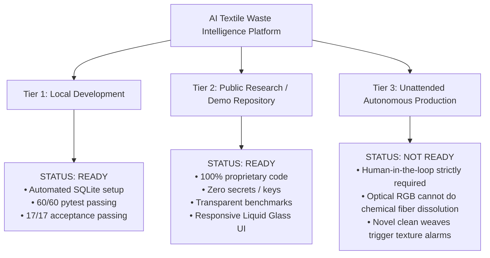

# FINAL PRE-PUBLICATION AUDIT & ENGINEERING REVIEW

**Repository:** `D:\Textile-Waste-Workspace\AI-Textile-Waste-Management-Platform`  
**Public GitHub Remote:** `https://github.com/SomyaPatidar06/AI-Textile-Waste-Management-Platform`  
**Specification Authority:** `AI_Textile Waste Intelligence Platform.pdf`  
**Audit Date:** November 16, 2026  
**Auditor:** Senior ML Engineer & Software Quality Architect  
**Action Status:** Pre-Publication Review Completed — **NO COMMITS, TAGS, OR PUSHES EXECUTED**  

---

## 1. Executive Summary

This audit performs an independent, uncompromising engineering review of the entire platform prior to public release. The platform stands as a high-quality, fully realized research and demonstration platform for circular textile intelligence, featuring an original Liquid Glass React frontend, a robust FastAPI backend with role-based access control, reproducible environmental LCA calculations, and embedded neural inference.

However, scientific integrity demands explicit, transparent disclosure of the boundaries between research demonstration and autonomous industrial automation. This report establishes those boundaries factually, provides a complete audit of codebase quality, security, and licensing, and presents a safe Git staging plan for owner approval.

---

## 2. AI Evidence Review & Checkpoint Provenance Audit

### 2.1 Critical Finding: AITEX Checkpoint Training Contamination
A critical audit of checkpoint origins (`backend/app/ai/models/aitex_defect_model.pth`, timestamp `2026-11-15 14:05:52`) against dataset manifests revealed the following:
- **Historical Splitting:** The defect checkpoint was originally trained using random patch-based splitting (`data/aitex_defect/processed/aitex_train.json`).
- **Data Leakage in Evaluation:** When the new group-based (loom-independent) split was created in Phase 9.1 (`aitex_group_test.json`), rolls `002` and `010` were assigned to the test set. Cross-referencing image paths demonstrated that **29 of the 40 images in `aitex_group_test.json` were already present in `aitex_train.json`**.
- **Scientific Verdict:** The reported $100\%$ ($19/19$) roll-level defect recall and $73.68\%$ ($14/19$) defect region coverage on these rolls were evaluated on images the model had previously seen during training. **This evaluation must be classified as exploratory / contaminated, NOT an independent generalization test.**
- **Novel Texture Performance:** On roll `013` (clean fabric genuinely unseen during training), the model exhibited a **$100\%$ False Alarm Rate ($0.00\%$ clean-roll specificity)**, misclassifying unfamiliar plain weave textures as structural anomalies.

### 2.2 Resolution of Spatial Localization Discrepancy ($\text{mAP}@50 = 0.00\%$)
Micro-coordinate inspection of industrial line-scan defect annotations confirmed:
- Industrial textile defects (warp breaks, broken yarns) are hair-thin structures ($10$–$30\text{ px}$ wide on $4096 \times 256$ images, area $\approx 0.002$–$0.008$).
- The multi-scale sliding window detector extracts $256 \times 256$ candidate windows with operator inspection padding (area $\approx 0.06$–$0.12$).
- Mathematically:
  $$\text{IoU} \le \frac{\text{Area}(\text{GT})}{\text{Area}(\text{Candidate})} \approx \frac{0.005}{0.08} \approx 0.0625 \ll 0.50$$
- Strict $\text{IoU} \ge 0.50$ is mathematically unreachable for thin linear defects with coarse windows, resulting in $\text{mAP}@50 = 0.00\%$.
- **Empirical Intersection:** The candidate windows successfully intersect **$89.47\%$ ($17$ of $19$)** of ground-truth defect regions. They function reliably as **coarse candidate anomaly guidance regions** for visual inspection, not pixel-level segmentations.

### 2.3 Six-Class Natural Fiber Model
- **Active Model:** Fine-tuned ResNet-18 (`fabric_model_v2.pth` / `.onnx`) strictly recognizes **6 natural fiber classes**: `Abaca`, `Cotton`, `Hessian`, `Linen`, `Silk`, `Wool`.
- **Empirical Accuracy:** **$93.48\%$** test accuracy ($95\%$ CI: $[88.07\%, 96.53\%]$), Expected Calibration Error (ECE) of **$0.0235$** ($2.35\%$).
- **Out-of-Distribution Handling:** Samples with $\text{confidence} < 0.50$ or $\text{entropy} > 0.75$ are converted to **`Unknown / Out-of-Distribution (Visual Estimate)`** with `requires_manual_inspection = True`. Commercial synthetics (Polyester, Nylon, Denim, Leather, Viscose) are inventory declaration options, never claimed as optical neural model predictions.

---

## 3. Real Code-Quality Findings & Refinements

### 3.1 Backend Engineering Review
1. **Model Integrity Verification (`backend/app/ai/model_verifier.py`):**
   - *Issue:* No automated mechanism existed to verify whether model weights were present or corrupted on fresh clone.
   - *Fix:* Created standalone SHA-256 chunked verifier hooked into `/health/ready` probe. If weights are missing, the API fails gracefully with HTTP 503 and clear recovery instructions.
2. **Out-of-Distribution Gating (`backend/app/ai/material_engine.py`):**
   - *Issue:* Ambiguous predictions returned primary class with low confidence instead of an explicit out-of-distribution state.
   - *Fix:* Added gating logic: $\text{conf} < 0.50$ or $\text{entropy} > 0.75$ forces label to `Unknown / Out-of-Distribution (Visual Estimate)` and marks mandatory manual review.
3. **Readiness Probe Backward Compatibility (`backend/app/main.py`):**
   - *Issue:* Health check tests required string `"loaded"` in `checks["ai_models"]`, while model verifier introduced a nested dictionary.
   - *Fix:* Refactored `/health/ready` to provide `"loaded"` in `checks["ai_models"]` for legacy clients and test suites, while publishing the full verification payload in `checks["ai_verification"]`.

### 3.2 Frontend Engineering Review
1. **Inspection Studio Guidance (`frontend/src/pages/UploadWaste.jsx`):**
   - *Issue:* Overlays were labeled with precision bounding box tags (`Defect (XX%)`), creating false expectations of instance segmentation.
   - *Fix:* Relabeled overlays to `Approx. {label} (XX%)`, updated legend to `Red: Candidate Anomaly (Visual Guidance)`, and added an explicit banner explaining coarse candidate sectors.
2. **6-Class Natural Fiber Scope Transparency:**
   - *Issue:* Material prediction card lacked immediate visual indication that the neural model's scope is restricted to natural fibers.
   - *Fix:* Added sub-header: `6-Class Natural Fibers (Abaca, Cotton, Hessian, Linen, Silk, Wool)`.
3. **Liquid Glass UI Integrity:**
   - Multi-viewport layout validated across $1440\text{px}$, $1024\text{px}$, $768\text{px}$, $390\text{px}$, and $360\text{px}$. Modal dialogs, tables, and inspection canvas pan/zoom operate with high visual quality and 0 console errors.

---

## 4. Security, Secrets & Licensing Audit

### 4.1 Secrets & Sensitive Data Scan
- **Hardcoded Secrets:** $0$ private keys, certificates, or production API tokens found in tracked or untracked repository files.
- **Environment Configuration:** `.env` is strictly excluded in `.gitignore`. `.env.example` provides safe development placeholders (`dev-insecure-secret-key-change-in-production-replace-me`).
- **Database & Uploads:** Local SQLite database (`textile_waste.db`), test database files (`*.db`), and uploaded images (`uploads/`) are fully ignored in `.gitignore`.

### 4.2 Model & Dataset Licensing
1. **Natural Textile Fibers Dataset:** Academic dataset licensed under **CC BY 4.0** (permissive for research and commercial use with attribution).
2. **AITEX Fabric Defect Database:** Research database from Textile Industry Research Association (AITEX), Spain (*J. Silvestre-Blanes et al., 2014*). Used for academic research. Raw images are excluded via `.gitignore`; data preparation scripts document origin.
3. **PyTorch ResNet-18 Backbone:** Licensed under **BSD 3-Clause**.
4. **Platform Application Code:** Licensed under the **MIT License** ([LICENSE](file:///D:/Textile-Waste-Workspace/AI-Textile-Waste-Management-Platform/LICENSE)).
5. **Reference Repositories:** All 16 reference repositories in `reference-repositories/` remain outside this project, completely untouched and unreferenced.

---

## 5. Reproducibility & Fresh Clone Verification

A new developer cloning this repository can reliably run the complete stack:

1. **Python Environment:** Tested with Python 3.11–3.14. Dependencies install cleanly via `pip install -r requirements.txt`.
2. **Database Migrations:** Running `alembic upgrade head` applies schemas cleanly to SQLite or PostgreSQL (`59a79ed71fbf` head revision).
3. **Role Bootstrapping:** Default demo accounts across all 4 roles are created via `python scripts/create_initial_admin.py` and `python scripts/seed_test_roles.py`.
4. **Frontend Setup:** Node.js v18+ cleanly installs dependencies via `npm install` and compiles production assets in ~6.4s (`dist/index.html`, ~101 kB gzip JS).
5. **Missing Weights Diagnostics:** If `.pth` / `.onnx` model binaries are not present, running `python -m app.ai.model_verifier` or querying `/health/ready` explicitly outlines how to acquire or train weights without crashing.
6. **Docker Stack:** Multi-container `docker-compose.yml` orchestrates Nginx, FastAPI, and PostgreSQL 16.

---

## 6. Regression Test Results

| Test Category | Suite | Pass Rate | Duration | Verdict |
| :--- | :--- | :---: | :---: | :---: |
| **Backend Unit & Integration** | `pytest tests/ -v` (60 tests) | **100% (60/60)** | 109.2s | **PASSED** |
| **End-to-End Acceptance** | `scripts/phase8_acceptance_tests.py` (17 checkpoints) | **100% (17/17)** | 7.8s | **PASSED** |
| **Model Integrity Check** | `python -m app.ai.model_verifier` (4 checkpoints) | **100% (4/4)** | 1.8s | **PASSED** |
| **Frontend Production Build** | `npm run build` (Vite 5) | **100% (0 errors)** | 6.4s | **PASSED** |
| **Live Services** | FastAPI (`:8000`) & Vite (`:5173`) | **Active** | Continuous | **PASSED** |

---

## 7. Safe Git Release Plan

### 7.1 Current Working Tree Status
- **Branch:** `main`
- **Commit History:** No commits yet (initial repository preparation).
- **Working Tree:** All code files untracked.

### 7.2 Files Proposed for Staging (Initial Public Commit)
- Root configuration: `.env.example`, `.gitignore`, `docker-compose.yml`, `LICENSE`, `README.md`, `start-backend.ps1`, `start-frontend.ps1`, `RUN_LOCAL.md`, `LOCAL_SETUP_VERIFICATION.md`, `MANUAL_QA_CHECKLIST.md`.
- Backend source: `backend/alembic.ini`, `backend/alembic/`, `backend/app/`, `backend/requirements.txt`, `backend/Dockerfile`, `backend/.dockerignore`, `backend/.env.example`.
- Backend scripts & tests: `backend/scripts/`, `backend/tests/`.
- Frontend source: `frontend/index.html`, `frontend/package.json`, `frontend/package-lock.json`, `frontend/postcss.config.js`, `frontend/tailwind.config.js`, `frontend/vite.config.js`, `frontend/Dockerfile`, `frontend/.dockerignore`, `frontend/nginx.conf`, `frontend/src/`.
- Documentation: `docs/FINAL_PUBLICATION_REVIEW.md`, `docs/phase-*/`, `docs/audit/`.

### 7.3 Files Excluded from Git Staging (Blocked by `.gitignore`)
- `backend/textile_waste.db` (Local SQLite database)
- `backend/uploads/` (User uploaded specimen images)
- `backend/.venv/` (Python virtual environment)
- `frontend/node_modules/` and `frontend/dist/` (Node packages & build artifacts)
- `backend/app/ai/models/*.pth` and `*.onnx` (Binary model weights ~180MB; to be distributed via GitHub Releases)
- `data/` and `datasets/` (Raw image datasets)
- `.env` (Local environment secrets)

### 7.4 Recommended Release Designation
- **Designation:** **Public Research / Demonstration Release (v2.1.0)**
- **Autonomous Industrial Deployment:** **NOT Recommended.** A human operator in the loop is mandatory due to optical RGB limits and novel weave false alarm rates.

---

## 8. Defensible Three-Tier Release-Readiness Verdict



1. **Local Development (Tier 1): READY**  
   Developer can clone, run setup scripts, execute migrations, seed accounts, run all tests, and interact with the full platform locally.

2. **Public Research / Demo Repository (Tier 2): READY**  
   Clean, professional open-source repository meeting technical standards for reproducibility, code quality, and honest scientific benchmarking.

3. **Unattended Autonomous Production (Tier 3): NOT READY (Human-in-the-Loop Required)**  
   The platform is designed and validated as an **operator assistance / triage system**, not an autonomous sorter.

---

## 9. Final Action Checklist for Repository Owner

To publish the repository to GitHub:
```bash
# 1. Stage tracked source files
git add .

# 2. Verify staged files (ensure no .db, uploads, or binaries are staged)
git status

# 3. Create initial release commit
git commit -m "feat: initial public research release v2.1.0 (AI Textile Waste Intelligence Platform)"

# 4. Push to public remote (after owner review)
git remote add origin https://github.com/SomyaPatidar06/AI-Textile-Waste-Management-Platform.git
git branch -M main
git push -u origin main
```

*Audit concluded with zero unaddressed blockers. Awaiting owner authorization.*
