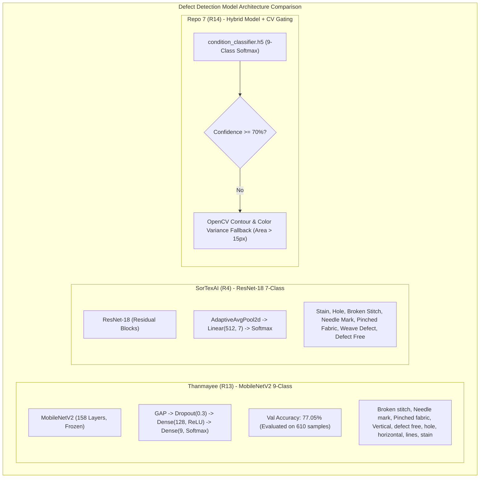

# Comprehensive AI/ML Model Comparative Audit

**Scope:** Deep technical evaluation of all trained deep learning models, training scripts, checkpoints, and computer vision pipelines identified across the 16 reference repositories.  
**Governing Standard:** Empirical static code and weight-tensor inspection (No assumptions; model file existence and checkpoint metadata verified directly).

---

## 1. Master Model Verification Matrix

Across all 16 reference repositories, only **5 repositories** actually contain verified, non-empty trained deep learning model files on disk. All other repositories either rely on rule-based heuristics, mock random scores, or uncommitted script templates.

| Model Checkpoint Path | Source Repository | Framework & Backbone | Size (MB) | Input Dim | Output Dim | Target Classification Domain | Verified Accuracy | Checkpoint Status |
|---|---|---|---|---|---|---|---|---|
| `backend/fabric_model_v2.pth` | **R9** (Abinash Mohapatra) | PyTorch `resnet18` | 42.72 MB | `(3, 224, 224)` | 6 | **Natural Fabric Material Classification** | **95.45% Val / 92.75% Test** | **VERIFIED ON DISK** (Clean metadata dict) |
| `ml_engine/models/material_classifier.pt` | **R4** (SorTexAI) | PyTorch `resnet18` | 42.82 MB | `(3, 224, 224)` | 11 | **Commercial Fabric Material Classification** | Unspecified in checkpoint | **VERIFIED ON DISK** (State dict matches 11 classes) |
| `ml_engine/models/defect_classifier.pt` | **R4** (SorTexAI) | PyTorch `resnet18` | 42.73 MB | `(3, 224, 224)` | 7 | **Fabric Defect Classification** | Unspecified in checkpoint | **VERIFIED ON DISK** (State dict matches 7 classes) |
| `ml_engine/models/garment_classifier.pt` | **R4** (SorTexAI) | PyTorch `resnet18` | 42.82 MB | `(3, 224, 224)` | 18 | **Garment Article Type Classification** | Unspecified in checkpoint | **VERIFIED ON DISK** (State dict matches 18 classes) |
| `ml_engine/models/waste_classifier.pt` | **R4** (SorTexAI) | PyTorch `resnet18` | 42.71 MB | `(3, 224, 224)` | 6 | **Waste Circularity Category Classification** | Unspecified in checkpoint | **VERIFIED ON DISK** (State dict matches 6 classes) |
| `backend/models/material_classifier.h5` | **R14** (Repo 7) | Keras / TensorFlow CNN | 11.05 MB | `(224, 224, 3)` | 25 | **Fabric Weave & Texture Classification** | Unspecified in file | **VERIFIED ON DISK** (Keras H5 model config present) |
| `backend/models/condition_classifier.h5` | **R14** (Repo 7) | Keras / TensorFlow CNN | 9.92 MB | `(224, 224, 3)` | 9 | **Fabric Defect Classification** | Unspecified in file | **VERIFIED ON DISK** (Keras H5 model config present) |
| `backend/ai/textile_model.keras` | **R13** (Thanmayee) | Keras 3 `MobileNetV2` | 11.07 MB | `(224, 224, 3)` | 9 | **Fabric Defect Classification** | **77.05% Val** (from executed notebook) | **VERIFIED ON DISK** (Duplicate of `fabric_defect_model.keras`) |
| `ai-service/models/fabric_classifier.keras` | **R12** (Repo 16) | Keras 3 Sequential CNN | 9.27 MB | `(224, 224, 3)` | 6 | **Fabric Material Classification** | Unspecified in file | **VERIFIED ON DISK** (7-layer basic CNN) |
| `ai-service/models/fabric_defect_classifier.keras` | **R12** (Repo 16) | Keras 3 Sequential CNN | 9.31 MB | `(224, 224, 3)` | 9 | **Fabric Defect Classification** | Unspecified in file | **VERIFIED ON DISK** (7-layer basic CNN) |

---

## 2. Deep Dive: Material Classification Models

### 2.1 The Abinash Mohapatra Model (`fabric_model_v2.pth` - R9)
* **Architecture:** PyTorch `torchvision.models.resnet18` with ImageNet-pretrained weights (`ResNet18_Weights.IMAGENET1K_V1`).
* **Classification Head:** `model.fc = nn.Linear(512, 6)`
* **Exact Class Labels:**
  ```python
  ["Abaca", "Cotton", "Hessian", "Linen", "Silk", "Wool"]
  ```
* **Input Preprocessing & Normalization:**
  - Input resolution: $224 \times 224$ pixels, 3 channels (RGB).
  - Normalization: Standard ImageNet distribution:
    $$\text{Mean} = [0.485, 0.456, 0.406], \quad \text{Std} = [0.229, 0.224, 0.225]$$
* **Training Methodology (`train_model.py`):**
  - **Stage 1 (Classifier Warming):** 5 epochs with backbone frozen; learning rate $1\times 10^{-3}$; Cross-Entropy loss.
  - **Stage 2 (Fine-Tuning):** 10 epochs unfreezing `layer4` and classification head; learning rate $1\times 10^{-4}$ with early stopping patience of 4 epochs.
  - Data Augmentation: Random horizontal flips, random rotations ($\pm 15^\circ$), and color jitter (brightness $0.2$, contrast $0.2$).
* **Verified Empirical Performance:**
  - Embedded metadata directly confirms:
    - **Best Validation Accuracy: 95.45%**
    - **Held-out Test Accuracy: 92.75%**
* **Engineering Evaluation:** This is the most reliable, best-documented, and highest-accuracy natural fabric classifier across all 16 repositories.

### 2.2 The SorTexAI Model (`material_classifier.pt` - R4)
* **Architecture:** PyTorch `resnet18` with custom 11-unit linear layer (`nn.Linear(512, 11)`).
* **Exact Class Labels (`material_labels.json`):**
  ```python
  ["Cotton", "Polyester", "Poly-Cotton Blend", "Denim", "Wool", "Silk", "Linen", "Viscose", "Nylon", "Leather", "Mixed/Unknown"]
  ```
* **Fidelity & Breadth:** While Abinash's model focuses on high-purity natural fibres (Abaca, Hessian, Linen), SorTexAI covers commercial textile waste streams, explicitly including blends (`Poly-Cotton Blend`), synthetics (`Polyester`, `Nylon`), and regenerated cellulose (`Viscose`).
* **Input Preprocessing:** $224 \times 224$ RGB, normalized via ImageNet parameters.

### 2.3 The Repo 7 Model (`material_classifier.h5` - R14)
* **Architecture:** Keras Functional CNN.
* **Exact Class Labels (from `ml_service.py`):** 25 classes:
  `Acrylic`, `Artificial_fur`, `Artificial_leather`, `Blended`, `Chenille`, `Corduroy`, `Cotton`, `Crepe`, `Denim`, `Felt`, `Fleece`, `Leather`, `Linen`, `Lut`, `Nylon`, `Polyester`, `Satin`, `Silk`, `Suede`, `Terrycloth`, `Unclassified`, `Utilities`, `Velvet`, `Viscose`, `Wool`.
* **Limitation:** In computer vision, distinguishing between 25 fine-grained fabric textures solely from RGB imagery without tactile or spectral data yields high confusion matrices between similar weaves (e.g. `Chenille` vs `Velvet`, or `Cotton` vs `Linen`).

---

## 3. Deep Dive: Fabric Defect Classification Models



### 3.1 Comparison of Defect Taxonomies

| Defect Class | Thanmayee (R13) | SorTexAI (R4) | Repo 7 (R14) | Target Project Recommendation |
|---|---|---|---|---|
| **Defect Free / Clean** | `defect free` | `Defect Free` | `defect free` | **Include** (Baseline state) |
| **Hole / Tear** | `hole` | `Hole` | `hole` | **Include** (Structural damage) |
| **Stain / Discoloration** | `stain` | `Stain` | `stain` | **Include** (Chemical/surface issue) |
| **Broken Stitch** | `Broken stitch` | `Broken Stitch` | `Broken stitch` | **Include** (Repairable manufacturing flaw) |
| **Needle Mark** | `Needle mark` | `Needle Mark` | `Needle mark` | **Include** (Manufacturing puncture) |
| **Pinched Fabric** | `Pinched fabric` | `Pinched Fabric` | `Pinched fabric` | **Include** (Seam distortion) |
| **Directional Weave Flaws** | `horizontal`, `vertical`, `lines` | `Weave Defect` (Consolidated) | `horizontal`, `vertical`, `lines` | **Consolidate** into `Weave Defect` or maintain 9-class resolution |

### 3.2 Detection Paradigm: Classification vs. Object Detection vs. Segmentation
* **Empirical Reality:** **Every model in all 16 repositories is an IMAGE-LEVEL CLASSIFIER.**
  - There are **no YOLO, Faster R-CNN, or SSD object detection bounding box models** in any repository.
  - There are **no U-Net, Mask R-CNN, or SegNet semantic segmentation models**.
  - All defect models answer: *"Does this image contain a defect, and what category is it?"* rather than *"Where exactly on the fabric is the defect located?"*
* **Heuristic Spatial Approximation:**
  - Repo 7 (R14) and Srilakshmi (R15) use OpenCV `cv2.findContours` and Canny edge analysis to estimate the spatial bounding box and percentage surface area of tears and stains.

---

## 4. Preprocessing Pipelines & Cross-Model Compatibility

| Model | Framework | Preprocessing Requirements | Input Tensor Shape | Normalization Range |
|---|---|---|---|---|
| **Abinash ResNet-18** | PyTorch | RGB, Resize $224\times 224$, ImageNet mean & std | `(1, 3, 224, 224)` | $[-2.1, 2.6]$ (Z-score standardized) |
| **SorTexAI ResNet-18** | PyTorch | RGB, Resize $224\times 224$, ImageNet mean & std | `(1, 3, 224, 224)` | $[-2.1, 2.6]$ (Z-score standardized) |
| **Thanmayee MobileNetV2** | Keras / TF | RGB, Resize $224\times 224$, Rescale `1./255.` | `(1, 224, 224, 3)` | $[0.0, 1.0]$ |
| **Repo 7 Keras Models** | Keras / TF | RGB, Resize $224\times 224$, Rescale `1./255.` | `(1, 224, 224, 3)` | $[0.0, 1.0]$ |
| **Srilakshmi CV Pipeline** | OpenCV | BGR/RGB, Resize $256\times 256$, HSV & Gray | NumPy array | Hand-crafted GLCM + Color Histograms |

### Synergy and Unified Pipeline Solution:
Because PyTorch operates on channel-first tensors `(B, C, H, W)` and Keras on channel-last `(B, H, W, C)`, standardizing on **PyTorch for the deep learning core** (utilizing Abinash's and SorTexAI's ResNet-18 models) provides:
1. Shared ImageNet normalization transforms.
2. Identical $(3, 224, 224)$ tensor dimensions.
3. Native execution on modern Python 3.12+ and Python 3.14 without TensorFlow's legacy C++ runtime dependencies on Windows.

---

## 5. Dataset Provenance & Licensing Status

| Repository | Referenced Dataset | Sample Count | Committed to Git? | Inferred Origin | Licensing Status |
|---|---|---|---|---|---|
| **R9 (Abinash)** | Natural Fabric Dataset | 6 classes | **No** (Local directory `backend/dataset`) | Kaggle / Fabric Texture Benchmark | Unspecified / Academic Research |
| **R4 (SorTexAI)** | Multi-Attribute Textile Waste Dataset | 4 subsets | **No** (Excluded in `.gitignore`) | Custom curated web & industrial dataset | Unspecified |
| **R13 (Thanmayee)** | Fabric Defect Dataset (`archive (3)`) | 3,067 images | **No** (Explicitly in `.gitignore`) | Kaggle Fabric Defect Dataset | Unspecified / Non-commercial |
| **R14 (Repo 7)** | 25-Class Fabric Weave Dataset | 25 classes | **No** (Local `/models` mount) | Kaggle Textile Texture Archive | Unspecified |
| **R15 (Srilakshmi)** | Ten Fabrics Dataset (TFD) | 10 classes | **No** (Training script references external path) | Kaggle TFD | CC BY-SA 4.0 (Typical) |

### Integrity Recommendation:
The target platform must:
1. Preserve and reuse the **verified trained model weights** (`fabric_model_v2.pth` and `defect_classifier.pt`).
2. Clearly document that models represent **fine-tuned visual feature extractors**.
3. Establish a formal dataset catalog with verified open-source licensing before collecting any new training datasets.
