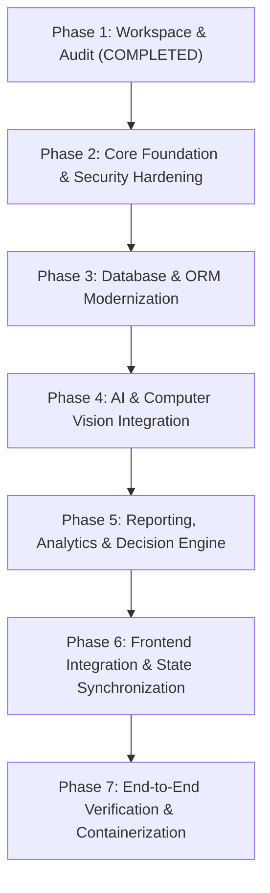

# Engineering Development Roadmap

**Project:** AI Textile Waste Management Platform  
**Target Architecture:** FastAPI + React + PostgreSQL 16 + Unified AI Pipeline (TensorFlow + OpenCV)  
**Execution Methodology:** Phased, Test-Driven Integration

---

## 1. Phased Implementation Roadmap

---

## 2. Detailed Milestone Specifications

### Milestone 1: Workspace Verification & Codebase Audit (Current State)
* **Status:** **DONE**
* **Deliverables:**
  - Complete source repository inspection and inventory.
  - Identification of architectural gaps, security flaws, and AI model characteristics.
  - Comprehensive documentation generated in `docs/audit/` and `AUDIT_REPORT.md`.
* **Exit Gate:** Formal review and user authorization before any code modification.

### Milestone 2: Backend Core Foundation & Security Hardening
* **Target Objective:** Establish clean, modular FastAPI directory structure and patch critical security vulnerabilities.
* **Key Tasks:**
  1. Scaffold clean backend structure:
     - `app/core/` (config, security, auth)
     - `app/models/` (SQLAlchemy 2.0 declarative models)
     - `app/schemas/` (Pydantic v2 validation models)
     - `app/routers/` (modular API routes)
     - `app/services/` (CV, AI inference, scoring, reporting)
  2. Implement Argon2id or Bcrypt password hashing.
  3. Implement strict role whitelisting on registration: deny self-assigned `"admin"` or `"sustainability_manager"`.
  4. Fix refresh token revocation check in `/api/auth/refresh`.
  5. Harden CORS settings with explicit origin whitelists.
  6. Enforce environment variable validation with Pydantic `BaseSettings`.
* **Exit Gate:** Security unit tests pass; admin escalation attempts are blocked with HTTP 403.

### Milestone 3: Database Layer Modernization & Schema Migration
* **Target Objective:** Migrate to a single, robust PostgreSQL 16 database with native JSONB support.
* **Key Tasks:**
  1. Define SQLAlchemy 2.0 ORM models for `User`, `RefreshToken`, `Inventory`, `Analysis`, and `Notification`.
  2. Replace dynamic string-concatenation update queries with ORM updates.
  3. Integrate Alembic for version-controlled database migrations.
  4. Implement `raw_cv_features` as a PostgreSQL `JSONB` column with GIN indexing to replace the MongoDB dependency.
* **Exit Gate:** Alembic migrations apply cleanly; all CRUD operations pass automated integration tests without raw SQL strings.

### Milestone 4: Dual-Stream AI Engine Integration
* **Target Objective:** Integrate the TensorFlow 9-class defect detection model and the OpenCV/XGBoost material classifier.
* **Key Tasks:**
  1. Import MobileNetV2 9-class defect classifier (`fabric_defect_model.keras`) and JSON class labels into `app/ml_models/`.
  2. Implement `DefectDetectionService`:
     - Image decoding & RGB validation.
     - Resizing to $(224, 224)$ with $[0, 1]$ normalization.
     - Model prediction and confidence extraction.
  3. Implement `MaterialClassificationService`:
     - Hand-crafted feature extraction (HSV histograms, GLCM texture, edge density).
     - XGBoost inference with rule-based fallback.
     - Output explicitly tagged as `"Visual Surface Estimate"`.
  4. Implement `UncertaintyGate`:
     - Flag low-confidence predictions ($< 0.45$).
     - Sanity check defect-free predictions against Canny contour edge density.
* **Exit Gate:** 100% of test images process cleanly through the pipeline with verified defect and material outputs in $< 100\text{ms}$.

### Milestone 5: Decision Engine, Sustainability & Reporting Hub
* **Target Objective:** Synthesize material and defect predictions into actionable circularity recommendations and exports.
* **Key Tasks:**
  1. Update circularity scoring algorithm to ingest defect severity deductions.
  2. Merge defect-specific repair actions into recycling decision tree.
  3. Port and modernize ReportLab PDF generators (single-item, batch, and sustainability certificates).
  4. Implement OpenPyXL Excel export and CSV streaming.
  5. Implement background email dispatch with rate limiting.
* **Exit Gate:** Batch report generation succeeds; PDF and Excel outputs match regulatory and domain standards.

### Milestone 6: Frontend Integration & State Synchronization
* **Target Objective:** Modernize React frontend and resolve race-condition upload defects.
* **Key Tasks:**
  1. Update `UploadWaste.jsx` to receive inserted database IDs directly from `/api/analyze-batch`, eliminating the race-prone `/history` polling flaw.
  2. Render combined Dual-AI results:
     - Primary badge: Visual Material Estimate (with disclaimer pill).
     - Secondary badge: AI-Detected Defect (with confidence percentage).
     - Contamination and texture quality indicators.
  3. Wire role-based dashboards to modular backend endpoints.
  4. Ensure complete responsive layout on mobile, tablet, and desktop viewports.
* **Exit Gate:** E2E user flow from image upload to PDF download verified without console errors.

### Milestone 7: Containerization & Final Production Verification
* **Target Objective:** Multi-container deployment and regression testing.
* **Key Tasks:**
  1. Author production multi-stage Dockerfiles for backend (Python 3.11/3.12 slim) and frontend (Node build + Nginx alpine).
  2. Configure production `docker-compose.yml` with health checks, volume persistence, and isolated networks.
  3. Execute automated E2E test suite across all user roles.
  4. Final documentation review and release tagging.
* **Exit Gate:** `docker compose up` starts all services cleanly from scratch; complete automated test suite passes.

---

## 3. Risk Management & Mitigation Matrix

| Identified Technical Risk | Severity | Probability | Proposed Mitigation Strategy |
|---|---|---|---|
| **TensorFlow Dependencies on Host / Windows** | High | Medium | Containerize backend or run headless TensorFlow in WSL2/Docker; use lightweight inference runtime or ONNX runtime if CPU footprint is a concern. |
| **Material Estimation Misinterpreted as Lab Spectroscopy** | High | High | Display mandatory visual estimate disclaimers in UI, PDF reports, and export headers. |
| **Defect Model Generalization on New Fabrics** | Medium | High | Implement uncertainty thresholding ($< 0.45$ triggers manual review) and cross-validate against OpenCV edge contours. |
| **Large File Upload Denial of Service** | Medium | Medium | Enforce strict file size limits (max 10MB per image, max 5 images per batch) and validate magic bytes before memory loading. |
| **Database Migration Data Loss** | High | Low | Use Alembic schema versioning with automated rollback scripts and strict PostgreSQL constraints. |
