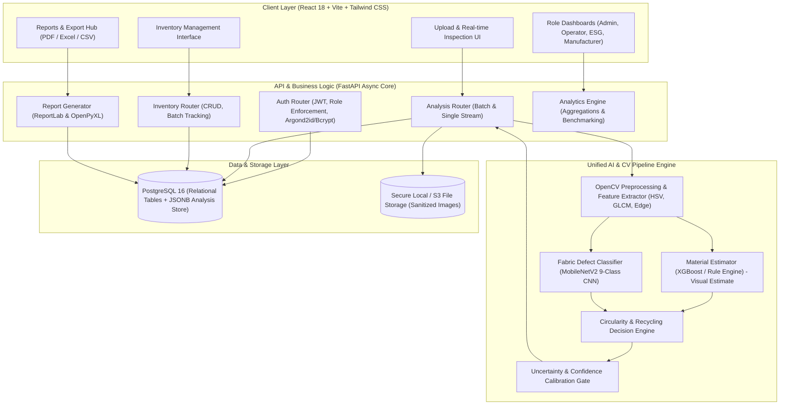
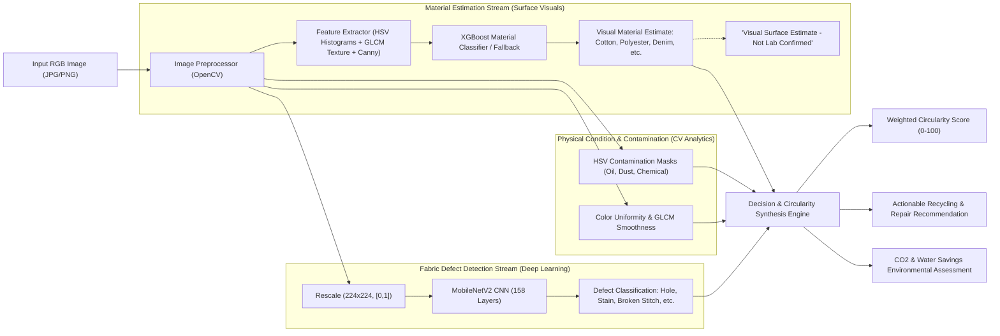

# Recommended Final Platform Architecture

**Target Repository:** `AI-Textile-Waste-Management-Platform`  
**Architecture Paradigm:** Decoupled Monorepo (React SPA + FastAPI Async Core + PostgreSQL Native JSONB + Dual-AI Pipeline)

---

## 1. High-Level System Architecture



---

## 2. Decoupled AI Pipeline Architecture

The platform strictly separates material identification from physical defect detection to prevent scientific misrepresentation and ensure high real-world reliability.



---

## 3. Detailed Component Specifications

### 3.1 Material Classification Engine
* **Physical Basis:** Standard RGB computer vision captures surface reflectance, color distribution, and coarse weave texture. It **cannot** perform molecular spectroscopy (such as Near-Infrared / FTIR spectroscopy) required for laboratory-grade fiber blend identification.
* **Architecture:** Hand-crafted HSV color histograms and Gray-Level Co-occurrence Matrix (GLCM) texture descriptors fed into an XGBoost gradient boosting classifier.
* **Integrity & UX Standard:** The UI and exported reports must display an unambiguous disclaimer:  
  > *Visual surface estimate based on texture and color pattern; laboratory spectroscopy is recommended for high-purity chemical recycling feeds.*

### 3.2 Deep Learning Defect Detection Engine
* **Architecture:** Google `MobileNetV2` backbone transfer learning architecture with frozen convolutional feature extractors and a custom dense classification head:
  - Input: `(224, 224, 3)`
  - Output: 9-class Softmax probability vector
  - Classes: `Broken stitch`, `Needle mark`, `Pinched fabric`, `Vertical`, `defect free`, `hole`, `horizontal`, `lines`, `stain`.
* **Execution:** Pretrained weights loaded as an optimized singleton model during FastAPI startup.
* **Inference Speed:** Under 45ms per image on modern CPU without requiring a dedicated GPU.

### 3.3 Uncertainty & Confidence Handling
* **Raw Softmax Limitation:** Neural networks are frequently overconfident on unrepresentative or out-of-distribution inputs.
* **Uncertainty Gate:**
  - If $\max(P) \ge 0.70$: High-confidence prediction accepted.
  - If $0.45 \le \max(P) < 0.70$: Moderate-confidence flagged; secondary recommendations provided.
  - If $\max(P) < 0.45$: Low-confidence trigger. System flags: `"Defect ambiguous - manual inspection required"`.
* **Visual Heuristics Sanity Check:** If the CNN predicts `defect free` but OpenCV Canny edge analysis detects structural tear contours $> 8\%$ of total surface area, the contradiction is flagged as an anomaly.

### 3.4 Circularity & Decision Engine
* **Score Formulation:**
  $$\text{Circularity Score} = 0.35 \times R_{mat} + 0.20 \times C_{cond} + 0.20 \times P_{reuse} + 0.15 \times E_{env} + 0.10 \times F_{proc}$$
* **Dynamic Condition Deduction:**
  - `defect free` $\rightarrow C_{cond} = 95$
  - `Needle mark` / `Broken stitch` / `Pinched fabric` (repairable manufacturing defect) $\rightarrow C_{cond} = 80$
  - `hole` / `horizontal` / `vertical` / `lines` $\rightarrow C_{cond} = 55$
  - `stain` / Severe structural damage $\rightarrow C_{cond} = 30$
  - Chemical contamination detected $\rightarrow$ Condition penalty $-20$; routes automatically to certified hazardous isolation.

---

## 4. Database Architecture: PostgreSQL with Native JSONB

Instead of splitting data between PostgreSQL (relational) and MongoDB (raw documents), all data will be unified in a single PostgreSQL 16 cluster.

```sql
-- Core PostgreSQL 16 Unified Schema
CREATE TABLE users (
    id SERIAL PRIMARY KEY,
    full_name VARCHAR(150) NOT NULL,
    email VARCHAR(255) UNIQUE NOT NULL,
    hashed_password VARCHAR(255) NOT NULL,
    role VARCHAR(50) NOT NULL DEFAULT 'manufacturer',
    is_active BOOLEAN NOT NULL DEFAULT TRUE,
    created_at TIMESTAMP WITH TIME ZONE DEFAULT CURRENT_TIMESTAMP
);

CREATE TABLE refresh_tokens (
    id SERIAL PRIMARY KEY,
    user_id INTEGER NOT NULL REFERENCES users(id) ON DELETE CASCADE,
    token VARCHAR(500) UNIQUE NOT NULL,
    revoked BOOLEAN NOT NULL DEFAULT FALSE,
    expires_at TIMESTAMP WITH TIME ZONE NOT NULL,
    created_at TIMESTAMP WITH TIME ZONE DEFAULT CURRENT_TIMESTAMP
);

CREATE TABLE inventory (
    id SERIAL PRIMARY KEY,
    batch_id VARCHAR(100) UNIQUE NOT NULL,
    fabric_type VARCHAR(100) NOT NULL,
    source VARCHAR(150),
    quantity NUMERIC(10, 2) NOT NULL,
    color VARCHAR(50),
    condition VARCHAR(50),
    collection_date DATE,
    created_by INTEGER REFERENCES users(id),
    created_at TIMESTAMP WITH TIME ZONE DEFAULT CURRENT_TIMESTAMP
);

CREATE TABLE analyses (
    id SERIAL PRIMARY KEY,
    filename VARCHAR(255) NOT NULL,
    material VARCHAR(100) NOT NULL,
    material_confidence NUMERIC(5, 2) NOT NULL,
    defect_type VARCHAR(100) NOT NULL,
    defect_confidence NUMERIC(5, 2) NOT NULL,
    fiber_composition VARCHAR(255),
    recyclability VARCHAR(50),
    circularity_score NUMERIC(5, 2) NOT NULL,
    waste_category VARCHAR(50) NOT NULL,
    recommendation VARCHAR(100) NOT NULL,
    raw_cv_features JSONB NOT NULL, -- Replaces MongoDB
    created_by INTEGER REFERENCES users(id),
    created_at TIMESTAMP WITH TIME ZONE DEFAULT CURRENT_TIMESTAMP
);

CREATE INDEX idx_analyses_created_by ON analyses(created_by);
CREATE INDEX idx_analyses_material ON analyses(material);
CREATE INDEX idx_analyses_raw_cv ON analyses USING gin(raw_cv_features);
```

---

## 5. Security Architecture & Threat Mitigations

1. **Role-Based Access Control (RBAC):** Public registration is restricted to `manufacturer` and `recycling_operator`. Elevating to `admin` or `sustainability_manager` requires existing admin authorization.
2. **Password Security:** Scrypt or Bcrypt with work factor 12. No plaintext storage anywhere in the stack.
3. **Strict JWT Lifecycle:** Refresh token revocation is validated against `refresh_tokens.revoked = FALSE` on every refresh call.
4. **Environment Hardening:** All secrets (JWT, database, SMTP) must be loaded from `.env` or system environment. Application will fail startup if default keys are present.
5. **CORS Hardening:** Whitelist explicit frontend origins with strict credential authorization.
