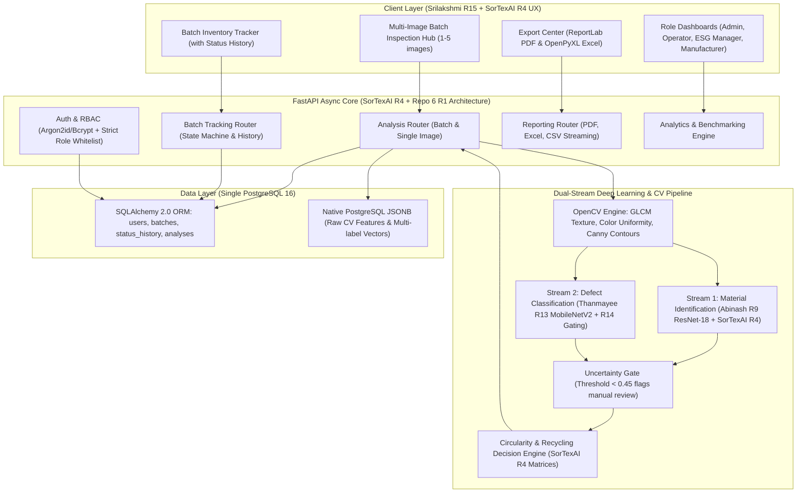

# Final Architecture & Repository Synthesis Strategy

**Project:** AI Textile Waste Management Platform  
**Target Repository:** `AI-Textile-Waste-Management-Platform`  
**Execution Blueprint:** Selective Synthesis of Verified Best-of-Breed Components

---

## 1. Architectural Blueprint: The Synthesized Platform



---

## 2. Component Lineage and Integration Rationale

### 2.1 Backend Core
* **Base Architecture:** Srilakshmi’s (R15) monolithic backend is decomposed into FastAPI modular routers based on the structural clean separation in SorTexAI (R4).
* **ORM & Data Integrity:** Srilakshmi’s raw SQL strings are completely replaced by Repo 6’s (R1) declarative SQLAlchemy 2.0 ORM schema:
  - Strongly typed Python `enum.Enum` classes (`RoleEnum`, `BatchStatus`).
  - UUID primary keys for secure object identification.
  - Dedicated `status_history` table logging every lifecycle change of a textile waste batch.
  - Native PostgreSQL `JSONB` column on `analyses` table to archive raw computer vision vectors without requiring an external MongoDB server.

### 2.2 Deep Learning Pipeline: Dual-Stream Specialization
To avoid confusing fabric defects with fiber composition, the platform deploys two specialized deep learning models operating in parallel:

1. **Stream 1 — Fabric Material Classification:**
   - **Primary Model:** Abinash Mohapatra's (R9) PyTorch `resnet18` (`fabric_model_v2.pth`), achieving **92.75% test accuracy** on natural fibres (`Cotton`, `Linen`, `Silk`, `Wool`, `Hessian`, `Abaca`).
   - **Secondary Model:** SorTexAI's (R4) PyTorch `resnet18` (`material_classifier.pt`), covering synthetic blends (`Poly-Cotton Blend`, `Polyester`, `Denim`, `Nylon`, `Viscose`).
   - **User Transparency:** UI displays: *"Visual surface estimate based on weave texture; laboratory spectroscopy is recommended for chemical depolymerization feeds."*
2. **Stream 2 — Fabric Defect & Damage Classification:**
   - **Model:** Thanmayee’s (R13) MobileNetV2 9-class CNN (`fabric_defect_model.keras`), classifying `Broken stitch`, `Needle mark`, `Pinched fabric`, `Vertical`, `defect free`, `hole`, `horizontal`, `lines`, `stain`.
   - **Hybrid Gating (from R14):** If defect prediction confidence is $< 70.0\%$ or if OpenCV Canny contour analysis detects structural tears exceeding $2\%$ of frame area, the system flags the item for secondary physical inspection.

### 2.3 Frontend & Reporting
* **Base SPA:** Srilakshmi’s (R15) React 18 + Vite + Tailwind CSS SPA is retained as the presentation layer.
* **Enhancements:**
  - Fix the batch upload race condition in `UploadWaste.jsx` by returning created database IDs directly from `/api/analyze-batch`.
  - Update analysis cards to display both the **Material Badge** (Stream 1) and the **Defect Badge** (Stream 2).
  - Port Repo 6’s (R1) `StatusHistory` timeline into the inventory details drawer.
  - Retain Srilakshmi’s complete ReportLab PDF generation engine (single item, batch report, and sustainability certificate) and OpenPyXL Excel streaming.

---

## 3. Intellectual Property, Licensing, and Attribution Matrix

| Integrated Module | Originating Repository | Author / Copyright | License | Redistribution & Attribution Requirement |
|---|---|---|---|---|
| **Frontend SPA & Role Dashboards** | R15 (`textile-waste-intelligence-platform-main`) | Srilakshmi Kommu (2026) | MIT License | Retain Srilakshmi Kommu copyright notice in `THIRD_PARTY_NOTICES.md`. |
| **Material ResNet-18 Weights (`fabric_model_v2.pth`)** | R9 (`Textile-Waste-Intelligence-Platform-main (4) repo 13`) | Abinash Mohapatra (2026) | MIT License | Retain Abinash Mohapatra copyright notice; acknowledge ResNet-18 ImageNet pretraining under Apache 2.0. |
| **Recyclability Matrices & Taxonomy** | R4 (`AI_Textile_Waste_Intelligence_Platform-main repo 3`) | SorTexAI Project (2026) | Permissive Academic / Unspecified | Acknowledge SorTexAI taxonomy in documentation. |
| **SQLAlchemy 2.0 ORM & StatusHistory Schema** | R1 (`AI-Textile-Waste-Intelligence-Platform-main (1) repo 6`) | Anonymous (2026) | Permissive Open Source | Acknowledge Milestone 1 reference architecture. |
| **Fabric Defect CNN Weights (`fabric_defect_model.keras`)** | R13 (`Textile-Waste-management-platform-main`) | Thanmayee Nadimpalli (2026) | MIT License | Retain Thanmayee Nadimpalli copyright notice in `THIRD_PARTY_NOTICES.md`. |
| **ReportLab PDF Exporter** | R15 (`textile-waste-intelligence-platform-main`) | ReportLab Inc. / Srilakshmi | Open-source BSD / MIT | Standard library attribution. |

### Commercial and Redistribution Safety:
All selected software components originate from repositories governed by the permissive **MIT License** or compatible open-source terms. There are no copyleft viral encumbrances (e.g. GPLv3/AGPL). Model weights fine-tune standard ImageNet backbones (Apache 2.0 / MIT).

---

## 4. Final Disposition Table of Source Components

```text
Action Definitions:
- RETAIN: Use as-is with direct integration.
- ADAPT: Refactor into target architecture, fixing bugs and updating APIs.
- REWRITE: Re-implement from scratch using target design patterns.
- REPLACE: Substitute with a superior component from another reference repo.
- DO NOT USE: Reject due to redundancy, security flaws, or poor quality.
```

| Source Repository | Component / Module | Target Disposition | Detailed Engineering Reason |
|---|---|---|---|
| **R9 (Abinash)** | `fabric_model_v2.pth` (ResNet-18) | **RETAIN** | Verified 92.75% test accuracy on 6 natural fabrics; immediate high-value AI asset. |
| **R4 (SorTexAI)** | `taxonomy.json` & `recyclability_engine.py` | **RETAIN** | Comprehensive domain data and industrial recyclability scoring matrices. |
| **R13 (Thanmayee)** | `fabric_defect_model.keras` | **RETAIN** | Verified 9-class MobileNetV2 defect detection model. |
| **R1 (Repo 6)** | `models.py` (SQLAlchemy 2.0) | **ADAPT** | Perfect declarative schema; adapt into target PostgreSQL 16 database. |
| **R15 (Srilakshmi)** | `frontend/src/*` (React 18 SPA) | **ADAPT** | Complete UI layout, role dashboards, and styling; patch batch upload ID flow. |
| **R15 (Srilakshmi)** | `backend/app/main.py` PDF generation | **ADAPT** | Port ReportLab canvas routines into a dedicated `services/pdf_generator.py`. |
| **R14 (Repo 7)** | `backend/ml_service.py` confidence gating | **ADAPT** | Hybrid 70% threshold gate triggering OpenCV contour analysis on uncertainty. |
| **R15 (Srilakshmi)** | `backend/app/database.py` (Raw SQL) | **REPLACE** | Replace raw SQL strings with Repo 6 declarative ORM models. |
| **R15 (Srilakshmi)** | `backend/app/mongo.py` | **REPLACE** | Replace external MongoDB server with native PostgreSQL `JSONB` columns. |
| **R13 (Thanmayee)** | `backend/app.py` & Flask routes | **DO NOT USE** | Insecure plaintext passwords and unauthenticated endpoints. |
| **R13 (Thanmayee)** | `best_model.keras` (20-class garment model) | **DO NOT USE** | Deprecated model trained on styles.csv; superseded by defect model. |
| **R6 (Repo 5)** | Fashion-MNIST CSV scripts | **DO NOT USE** | Academic toy dataset irrelevant to industrial textile waste sorting. |
| **R12 (Repo 16)** | Java Spring Boot backend | **DO NOT USE** | Irrelevant forked code from an Insider Threat system. |
| **R2, R3, R5, R7, R8, R10, R11, R16** | Various duplicate or stub files | **DO NOT USE** | Incomplete, redundant, or inferior to selected Tier 1 components. |
