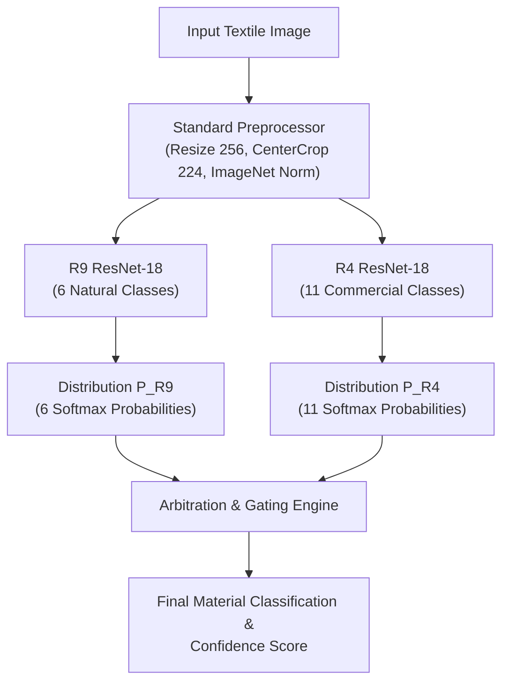
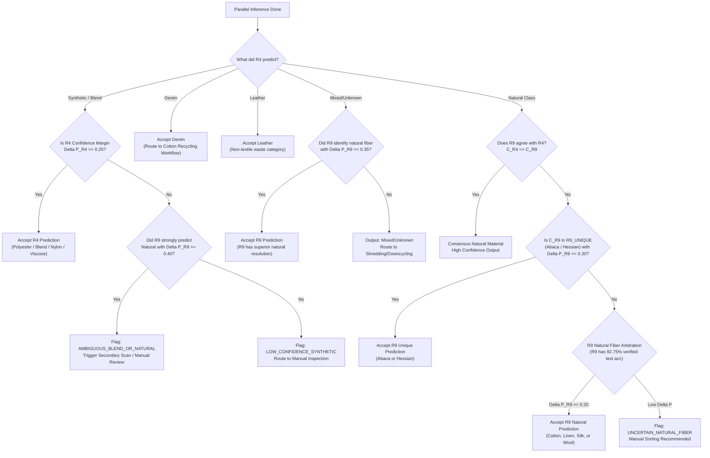

# Material Model Inference Routing and Arbitration Design

**Project:** AI Textile Waste Management Platform  
**Document ID:** `AUDIT-PHASE-1.6-DELIV-03`  
**Target Repository:** `D:\Textile-Waste-Workspace\AI-Textile-Waste-Management-Platform`  
**Audit Phase:** Phase 1.6 — Integration Readiness and Evidence Verification  
**Status:** COMPLETE / AUDIT-ONLY  

---

## 1. Objective and Problem Definition

The platform has identified two high-potential candidate models for textile material classification:
1. **R9 ResNet-18 (Natural Fibers):** Highly accurate (92.75% verified test accuracy) across 6 natural plant and animal fibers (`Abaca`, `Cotton`, `Hessian`, `Linen`, `Silk`, `Wool`). It has zero training on synthetic polymers or commercial blends.
2. **R4 ResNet-18 (Commercial Waste Streams):** Broad operational coverage across 11 classes, including synthetic polymers (`Polyester`, `Nylon`), blends (`Poly-Cotton Blend`), heavy weaves (`Denim`), semi-synthetics (`Viscose`), animal skins (`Leather`), and `Mixed/Unknown`. Its empirical accuracy is unverified.

### The Fundamental Dilemma
- If an input garment made of **Polyester** or a **Poly-Cotton Blend** is evaluated solely by R9, R9's closed-world softmax layer will force the prediction into one of its 6 natural fiber classes (often `Cotton` or `Silk`), frequently with deceptive >80% softmax confidence.
- Conversely, if evaluated solely by R4, the classification may suffer from lower discriminatory precision on natural fibers compared to R9's specialized head.
- **Goal:** Design an inference routing policy and arbitration protocol that leverages R9's verified natural fiber precision while utilizing R4's broad commercial taxonomy, resolving overlapping labels, handling uncalibrated confidence scores, and safely triggering manual inspection.

---

## 2. Taxonomy Mapping & Label Overlap Analysis

```
R9 Taxonomy (6 Classes)                R4 Taxonomy (11 Classes)
┌────────────────────────┐             ┌────────────────────────┐
│ Abaca                  │ [Unique R9] │                        │
│ Hessian                │ [Unique R9] │                        │
│ Cotton                 │◄───────────►│ Cotton                 │ [Direct Overlap]
│ Linen                  │◄───────────►│ Linen                  │ [Direct Overlap]
│ Silk                   │◄───────────►│ Silk                   │ [Direct Overlap]
│ Wool                   │◄───────────►│ Wool                   │ [Direct Overlap]
│                        │             │ Polyester              │ [Unique R4 - Synthetic]
│                        │             │ Poly-Cotton Blend      │ [Unique R4 - Blend]
│                        │             │ Denim                  │ [Unique R4 - Heavy Twill]
│                        │             │ Viscose                │ [Unique R4 - Semi-Synthetic]
│                        │             │ Nylon                  │ [Unique R4 - Synthetic]
│                        │             │ Leather                │ [Unique R4 - Skin]
│                        │             │ Mixed/Unknown          │ [Unique R4 - Fallback]
└────────────────────────┘             └────────────────────────┘
```

### Label Relationship Categories:
1. **Direct Overlap (4 Classes):** `Cotton`, `Linen`, `Silk`, `Wool`.
2. **R9 Specific Naturals (2 Classes):** `Abaca` (Manila hemp), `Hessian` (burlap/jute). These are industrial plant fibers that R4 would likely misclassify as `Linen` or `Mixed/Unknown`.
3. **R4 Synthetics & Blends (4 Classes):** `Polyester`, `Poly-Cotton Blend`, `Nylon`, `Viscose`. Completely absent from R9's hypothesis space.
4. **R4 Specialized Materials (3 Classes):** `Denim` (heavy cotton twill), `Leather`, `Mixed/Unknown`.

---

## 3. Parallel Execution Strategy

Both models are lightweight ResNet-18 backbones (~11.18 million parameters, ~42.8 MB each).
- **Execution Cost:** On standard CPU hardware, each model performs forward inference in ~25–30 ms.
- **Total Latency:** Running both sequentially or concurrently in a thread pool requires <60 ms total, well within the target interactive latency envelope (<200 ms).
- **Policy Decision:** **Both models will execute in parallel on every uploaded material image.** This provides two independent probability distributions for every sample.



---

## 4. Confidence Calibration and Uncertainty Metrics

### 4.1 The Flaw of Raw Softmax
Raw softmax outputs are calculated as:
$$\sigma(z)_i = \frac{e^{z_i}}{\sum_{j=1}^K e^{z_j}}$$
Deep neural networks are known to produce uncalibrated, overconfident predictions on out-of-distribution inputs. For example, feeding an image of a polyester shirt to R9 can yield $\max(\sigma(z)) = 0.88$ for `Cotton` simply because the logits $z$ were scaled by unregularized weights.
**Rule:** Raw softmax $\max(P)$ must **never** be interpreted as a true Bayesian probability.

### 4.2 Required Dispersion and Uncertainty Metrics
The arbitration engine computes three metrics for each model output:
1. **Top-1 Score:** $P_{(1)} = \max_i P_i$
2. **Confidence Margin ($\Delta P$):** Difference between Top-1 and Top-2 probabilities:
   $$\Delta P = P_{(1)} - P_{(2)}$$
   A high $\Delta P$ indicates unambiguous class separation; a low $\Delta P$ (< 0.20) indicates high decision ambiguity.
3. **Normalized Entropy ($H$):**
   $$H(P) = -\frac{1}{\ln K} \sum_{i=1}^K P_i \ln(P_i + \epsilon)$$
   $H \in [0, 1]$. An entropy approaching 1.0 indicates a flat, highly uncertain distribution.

---

## 5. Hierarchical Arbitration Protocol

Let $C_{R4}$ and $P_{R4}$ be R4's predicted class and top probability.  
Let $C_{R9}$ and $P_{R9}$ be R9's predicted class and top probability.  
Let $\text{NATURAL} = \{\text{Cotton, Linen, Silk, Wool}\}$.  
Let $\text{SYNTHETIC\_BLEND} = \{\text{Polyester, Poly-Cotton Blend, Nylon, Viscose}\}$.  
Let $\text{SPECIALIZED} = \{\text{Denim, Leather, Mixed/Unknown}\}$.  
Let $\text{R9\_UNIQUE} = \{\text{Abaca, Hessian}\}$.  

### Decision Logic Tree



### Detailed Arbitration Rules:

#### Case 1: R4 Predicts Synthetic / Blend
- If R4 predicts `Polyester`, `Poly-Cotton Blend`, `Nylon`, or `Viscose` with margin $\Delta P_{R4} \ge 0.25$:
  - **Action:** Accept R4's prediction.
  - **Rationale:** R9 is incapable of recognizing synthetic polymers and will always misclassify them. R4 is the authoritative detector for synthetics.
- If $\Delta P_{R4} < 0.25$ and R9 predicts a natural fiber with high confidence ($\Delta P_{R9} \ge 0.40$):
  - **Action:** Output `Poly-Cotton Blend (Suspected)` or flag for operator review.
  - **Rationale:** Synthetic-natural borderline cases (e.g. 65/35 poly-cotton) frequently trigger split confidence between the synthetic detector and the natural detector.

#### Case 2: R4 Predicts Natural Fiber (`Cotton`, `Linen`, `Silk`, `Wool`)
- If $C_{R4} == C_{R9}$:
  - **Action:** Accept prediction with combined confidence $\min(1.0, 0.6 \cdot P_{R9} + 0.4 \cdot P_{R4})$.
  - **Rationale:** Dual-model consensus on identical natural classes represents maximum reliability.
- If $C_{R4} \ne C_{R9}$:
  - If R9 predicts `Abaca` or `Hessian` with $\Delta P_{R9} \ge 0.30$:
    - **Action:** Accept R9. (R4 lacks Abaca/Hessian in its vocabulary and misclasses them as Cotton/Linen).
  - Else (disagreement between Cotton, Linen, Silk, Wool):
    - **Action:** Default to R9's prediction provided $\Delta P_{R9} \ge 0.20$.
    - **Rationale:** R9 holds empirically verified test accuracy of 92.75% on these specific classes, whereas R4 has unverified empirical accuracy.

#### Case 3: R4 Predicts `Denim`
- Denim is structurally heavy twill cotton with indigo dye.
- If R4 predicts `Denim` and R9 predicts `Cotton`:
  - **Action:** Output `Denim (100% Cotton Base)`. This provides rich downstream context: mechanical shredding can process it as cotton, while resale/repair treats it as denim garments.

---

## 6. Manual Inspection Trigger Conditions

The automated routing engine must refuse automated sorting and trigger human inspection under any of the following four conditions:

1. **Severe Model Deadlock:** R4 predicts a synthetic fiber with high confidence ($P_{R4} \ge 0.75$), but R9 predicts a natural fiber with equally high confidence ($P_{R9} \ge 0.75$), and neither is `Poly-Cotton Blend`.
2. **Double Ambiguity (High Entropy):** Both models yield normalized entropy $H > 0.70$ or margin $\Delta P < 0.15$.
3. **Low Top-1 Ceiling:** $\max(P_{R4}) < 0.40$ AND $\max(P_{R9}) < 0.40$. The fabric pattern is completely outside both training distributions (e.g., metallic fabrics, PVC, heavily degraded composites).
4. **Physical Downstream Risk:** Any material flagged as potentially containing hazardous contaminants or unclassified industrial waste.

When a manual inspection is triggered:
- The system returns `status: "REQUIRES_MANUAL_INSPECTION"`.
- Both model probability distributions are surfaced in the UI.
- The item is routed to the human operator queue with flagged uncertainty reasons.
