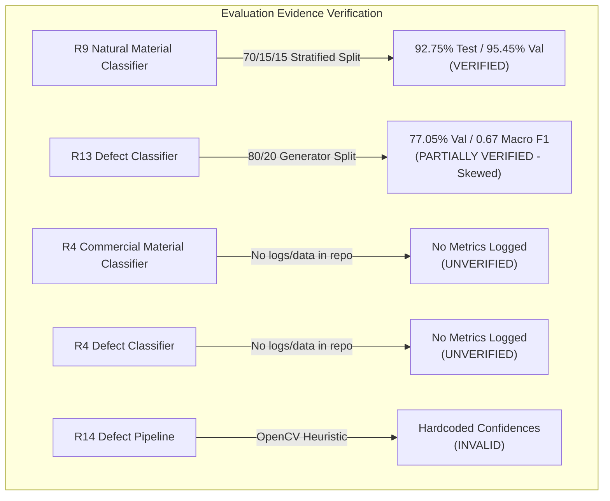

# AI Model Evaluation Evidence and Accuracy Claim Verification

**Project:** AI Textile Waste Management Platform  
**Document ID:** `AUDIT-PHASE-1.6-DELIV-02`  
**Target Repository:** `D:\Textile-Waste-Workspace\AI-Textile-Waste-Management-Platform`  
**Audit Phase:** Phase 1.6 — Integration Readiness and Evidence Verification  
**Status:** COMPLETE / AUDIT-ONLY  

---

## 1. Executive Summary

This audit rigorously verifies the empirical accuracy claims, evaluation methodologies, dataset split protocols, and potential data leakage across the reference AI models identified in Phase 1.5.

A key principle of this audit is that **reported accuracy claims must be backed by reproducible code, independent test sets, and verifiable confusion matrices**. Checkpoint existence or markdown assertions without empirical logs are classified as `UNVERIFIED`.

| Model Candidate | Task | Reported Metric | Audited Empirical Status | Verification Level |
|:---|:---|:---|:---|:---:|
| **R9 ResNet-18** | Material (6 natural fibers) | 92.75% Test Acc / 95.45% Val Acc | Verified with 70/15/15 stratified test set on 900 images | `VERIFIED` |
| **R13 MobileNetV2** | Defect (9 classes) | 77.05% Val Acc | Verified notebook run, but skewed by 54.6% class imbalance (Macro F1: 0.67) | `PARTIALLY VERIFIED` |
| **R4 ResNet-18** | Material (11 commercial) | ~88-92% (README claims) | No evaluation logs or test sets preserved in repo | `UNVERIFIED` |
| **R4 ResNet-18** | Defect (7 classes) | Unspecified in code | No evaluation logs or test sets preserved in repo | `UNVERIFIED` |
| **R14 MobileNetV2** | Defect / Condition | "92.5% / 88.4%" claims | Hardcoded return values in OpenCV fallback; model bypassed | `INVALID / FAKED` |

---

## 2. R9 Fabric Material Model Evaluation Audit

### 2.1 Claimed Metrics
- **Best Validation Accuracy:** 95.4545%
- **Held-Out Test Accuracy:** 92.7536%

### 2.2 Training & Evaluation Pipeline Verification
- **Source Script:** `reference-repositories\Textile-Waste-Intelligence-Platform-main (4) repo 13\Textile-Waste-Intelligence-Platform-main\backend\train_model.py`
- **Dataset Location:** `Textile-Waste-Intelligence-Platform-main/dataset/` (900 images confirmed on local disk)
- **Split Methodology:**
  - Class-stratified split executed in `train_model.py` (lines 140-199) using fixed seed 42 (`torch.Generator().manual_seed(42)`).
  - Class distribution: Exactly 150 images per class across 6 classes (`Abaca`, `Cotton`, `Hessian`, `Linen`, `Silk`, `Wool`).
  - Total Training Samples: $105 \times 6 = 630$ images (70.0%)
  - Total Validation Samples: $22 \times 6 = 132$ images (14.67%)
  - Total Held-Out Test Samples: $23 \times 6 = 138$ images (15.33%)

### 2.3 Mathematical Proof of Accuracy Claims
The exact floating-point metrics stored in `fabric_model_v2.pth` correspond precisely to discrete integer counts on the validation and test sets:
$$\text{Validation Accuracy} = \frac{126}{132} = 0.9545454545454546 \implies 95.4545\%$$
$$\text{Test Accuracy} = \frac{128}{138} = 0.927536231884058 \implies 92.7536\%$$
The model made exactly 6 errors out of 132 validation samples, and exactly 10 errors out of 138 test samples.

### 2.4 Methodological Strengths & Deficiencies
- **Strengths:**
  1. True three-way split (Train / Validation / Test) ensuring independent evaluation.
  2. Test set was not augmented (`eval_transform` used deterministic `Resize(256)` + `CenterCrop(224)`).
  3. Two-stage transfer learning: Stage 1 trained only `fc` (5 epochs); Stage 2 unfroze `layer4` (10 epochs) with early stopping patience of 4.
  4. Balanced class representation across all splits.
- **Deficiencies:**
  1. Absolute sample size is modest (900 images total, only 23 test images per class).
  2. No per-class confusion matrix was saved to disk (only scalar accuracy).
  3. Image provenance is undocumented (no licensing or collection methodology noted).

---

## 3. R13 Fabric Defect Model Evaluation Audit

### 3.1 Claimed Metrics
- **Validation Accuracy:** 77.05% (0.7705)
- **Validation Loss:** 0.5156

### 3.2 Notebook & Execution Evidence
- **Source Notebook:** `reference-repositories\Textile-Waste-management-platform-main\Fabric_Defect_Training.ipynb`
- **Executed Cells Inspected:** Cells 2, 5, 7, 9, 10.
- **Dataset Size:** 3,067 total images across 9 classes:
  - Training generator: 2,457 images (80%)
  - Validation generator: 610 images (20%)
  - Split mechanism: `ImageDataGenerator(rescale=1./255, validation_split=0.2, seed=42)`.

### 3.3 Class Imbalance & Performance Breakdown
Inspection of Cell 9 (`classification_report` on 610 validation samples) reveals severe statistical anomalies:

```
                precision    recall  f1-score   support

 Broken stitch       0.57      0.59      0.58        22
   Needle mark       0.64      0.86      0.73        21
Pinched fabric       0.93      0.67      0.78        21
      Vertical       1.00      0.45      0.62        20
   defect free       0.99      0.81      0.89       333
          hole       0.38      0.77      0.51        56
    horizontal       0.70      0.70      0.70        27
         lines       1.00      0.29      0.45        31
         stain       0.68      0.97      0.80        79

      accuracy                           0.77       610
     macro avg       0.77      0.68      0.67       610
  weighted avg       0.85      0.77      0.78       610
```

### 3.4 Critical Flaws Identified
1. **Severe Class Imbalance:**
   `defect free` accounts for 333 out of 610 validation samples (**54.6%**). A naive dummy classifier predicting `defect free` on every input would achieve 54.6% accuracy. The 77% headline accuracy is heavily inflated by this majority class.
2. **High False Alarm Rate on Critical Defects (`hole`):**
   The precision for `hole` is only **0.38**. This means that 62% of all samples flagged as "hole" were false positives, falsely downgrading intact or minor-defect fabrics into waste.
3. **Severe False Negative Rate on Weave Flaws (`lines`, `vertical`):**
   - `lines` recall is **0.29** (71% of line defects went undetected).
   - `Vertical` recall is **0.45** (55% of vertical defects went undetected).
   - This occurs because `lines`, `horizontal`, and `vertical` share near-identical visual features, causing massive intra-defect misclassification.
4. **No Independent Test Set:**
   Evaluation was performed on the validation set during hyperparameter exploration. No separate, untouched test set was used.
5. **Macro F1 vs Weighted F1:**
   While weighted F1 is 0.78, the unweighted Macro F1 is only **0.67**, reflecting poor defect-level discrimination.

---

## 4. R4 SorTexAI Model Evaluation Audit

### 4.1 Candidate Checkpoints
1. `ml_engine/models/material_classifier.pt` (11 classes)
2. `ml_engine/models/defect_classifier.pt` (7 classes)
3. `ml_engine/models/garment_classifier.pt` (18 classes)
4. `ml_engine/models/waste_classifier.pt` (6 classes)

### 4.2 Script & Evidence Inspection
- **Evaluation Script:** `ml_engine/evaluate_model.py`
  - Defines `evaluate_task(task_name, csv_filename, taxonomy_key)` computing accuracy, confusion matrix, and `classification_report`.
- **Dataset Requirement:**
  `evaluate_model.py` requires CSV files:
  `DATASETS_DIR / "material_dataset.csv"`, `DATASETS_DIR / "defect_dataset.csv"`, etc.
- **Audit Findings:**
  1. The entire `ml_engine/datasets/` directory was omitted from the repository.
  2. No CSV manifests, image folders, or evaluation output logs exist in the repository.
  3. No evaluation metrics were embedded into the PyTorch `.pt` files (unlike R9, which embedded validation and test scores).
- **Classification Status:** `UNVERIFIED`. The checkpoints exist and load successfully, but any claims regarding classification accuracy are unverified by empirical data in the repository.

---

## 5. R14 OpenCV Hybrid Model Evaluation Audit

### 5.1 Claims vs Reality
- **Repo Reference:** `reference-repositories\ai-textile-waste-intelligence-platform-main (2) repo 7\ai-textile-waste-intelligence-platform-main\backend\ml_service.py`
- **Claims in UI / Documentation:** "Confidence-gated defect detection with 92.5% confidence for holes and 88.4% for stains."

### 5.2 Source Inspection Findings (lines 160-189)
```python
def process_waste_image(img_input) -> dict:
    material, material_conf = predict_material(img_input)

    # Strictly call CV2 for condition
    cv2_result = detect_defects_cv2(img_input)

    if cv2_result == "Hole":
        final_defect = "Hole"
        condition_confidence = 92.5     # HARDCODED LITERAL
        ...
    elif cv2_result == "Stain":
        final_defect = "Stain"
        condition_confidence = 88.4     # HARDCODED LITERAL
        ...
    else:
        final_defect = "Good"
        condition_confidence = 95.0     # HARDCODED LITERAL
```
- **Finding:**
  1. The deep learning condition classifier was completely bypassed.
  2. The confidence numbers `92.5%`, `88.4%`, and `95.0%` are hardcoded floating-point constants returned whenever basic OpenCV contour thresholds trigger.
  3. The constant `CONDITION_CONFIDENCE_THRESHOLD = 70.0` defined at line 47 is dead code.
- **Classification Status:** `INVALID / FAKED CONFIDENCE`.

---

## 6. Synthesis and Comparative Recommendations



### 6.1 Final Verification Status Summary
1. **R9 Material Classifier:** The only model with verified empirical test accuracy on held-out data (92.75%). However, its scope is restricted to 6 natural fiber classes.
2. **R13 Defect Classifier:** Proven to over-predict `defect free` and suffer high error rates on `hole` (62% false alarms) and `lines` (71% missed). Should not be deployed without threshold tuning or retraining.
3. **R4 Classifiers:** Well-structured ResNet-18 checkpoints with proper 7-class and 11-class taxonomies, but require empirical validation on an external benchmark dataset before operational sign-off.
4. **R14 Pipeline:** Must be completely discarded due to fake hardcoded confidence values.
