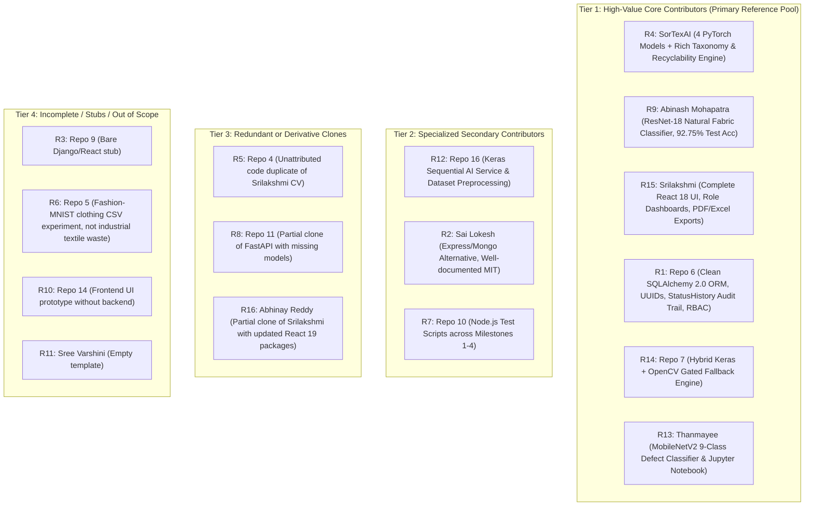

# Comprehensive Multi-Repository Comparative Audit

**Project:** AI Textile Waste Management Platform  
**Target Repository:** `https://github.com/SomyaPatidar06/AI-Textile-Waste-Management-Platform`  
**Audit Scope:** Full static evaluation of all 16 extracted repositories in `reference-repositories/`  
**Date:** 2026-11-15  
**Governing Rule:** Audit Only — Strictly No Implementation Yet

---

## 1. Executive Discovery & Overview of Repositories

A comprehensive filesystem scan of `D:\Textile-Waste-Workspace\reference-repositories` identified **16 distinct reference folders**. Each folder was statically inspected to determine its actual repository root, provenance, commit/license metadata, technology stack, AI assets, database architecture, and feature set.

### Master Repository Inventory

| # | Folder Identifier | Identified Project Name | Primary Author / Copyright | Core Tech Stack | AI Models Present | Test Files | License Status |
|---|---|---|---|---|---|---|---|
| **R1** | `AI-Textile-Waste-Intelligence-Platform-main (1) repo 6` | Textile Waste Intelligence Platform (M1) | Unknown (Anonymous) | Python (FastAPI), React 18, SQLAlchemy, PostgreSQL/SQLite | None | 3 test suites (`test_auth`, `test_batches`, `conftest`) | No LICENSE file |
| **R2** | `AI-Textile-Waste-Intelligence-Platform-main repo 8` | AI Textile Waste Intelligence Platform | Sai Lokesh Reddy Pannala | Node.js (Express), React 19, MongoDB (Mongoose) | None | 0 tests | MIT License (2026) |
| **R3** | `AI-TextileWaste-main repo 9` | AI-TextileWaste | Unknown (Anonymous) | Django / SQLite stub, React 19 (Vite) | None | 1 test file | No LICENSE file |
| **R4** | `AI_Textile_Waste_Intelligence_Platform-main repo 3` | SorTexAI Platform | Unknown (SorTexAI Core) | Python (FastAPI), React 19 (Next.js), PyTorch, MongoDB Atlas | **4 PyTorch ResNet-18 Models** (`material`, `defect`, `garment`, `waste`) | 1 test file | No LICENSE file |
| **R5** | `AI_Textile_Waste_Intelligence_Platform-main repo 4` | AI Textile Waste Platform (CV Clone) | Unknown (Anonymous) | Python (FastAPI), React 19, OpenCV, PostgreSQL | None (Code copy of Srilakshmi CV) | 0 tests | No LICENSE file |
| **R6** | `AI_textile_waste_management_system-main repo 5` | AI Textile Waste System | Unknown (Anonymous) | Node.js (Express), React 19, MongoDB, Fashion-MNIST CSV | None | 4 tests (`test_db`, `test_jwt`, etc.) | Empty LICENSE file |
| **R7** | `Textile-Waste-Intelligence-Platform-main (1) repo 10` | Textile Waste Intelligence Platform (M1-4) | Unknown (Anonymous) | Node.js (Express), React 18, SQLite | None | 3 test suites (`test_milestone1`, `test_milestone4`, `test_sustainability`) | No LICENSE file |
| **R8** | `Textile-Waste-Intelligence-Platform-main (2) repo 11` | Textile Waste Intelligence Platform | Unknown (Anonymous) | Python (FastAPI), React 19, Chart.js | None | 1 test file | No LICENSE file |
| **R9** | `Textile-Waste-Intelligence-Platform-main (4) repo 13` | Textile Waste Intelligence API | Abinash Mohapatra | Python (FastAPI), Next.js / React 19, PyTorch, ReportLab | **2 PyTorch ResNet-18 Models** (`fabric_model_v2.pth` - 92.75% test acc) | 1 test script | MIT License (2026) |
| **R10** | `Textile-Waste-Intelligence-Platform-main (5) repo 14` | Textile Waste Platform Stub | Unknown (Anonymous) | React 19 Frontend Stub (No backend) | None | 1 test stub | No LICENSE file |
| **R11** | `Textile-Waste-Intelligence-Platform-main (6) repo 15` | Textile Waste Platform | Sree Varshini Prasangi | Empty Skeleton (README + LICENSE only) | None | 0 tests | MIT License (2026) |
| **R12** | `Textile-Waste-Management-AI-main repo 16` | Textile Waste AI / Insider Threat Hybrid | Unknown (Forked Java App + AI) | Python (FastAPI), Java (Spring Boot), React 19, Keras 3 | **2 Keras 3 Models** (`fabric_classifier`, `fabric_defect_classifier`) | 1 Java test | No LICENSE file |
| **R13** | `Textile-Waste-management-platform-main` | AI Textile Waste Management System | Thanmayee Nadimpalli | Python (Flask), React 19, PostgreSQL, Keras 3 | **3 Keras Checkpoints** (`textile_model.keras` - MobileNetV2 9-class) | 1 test file | MIT License (2026) |
| **R14** | `ai-textile-waste-intelligence-platform-main (2) repo 7` | AI Textile Waste Intelligence Platform | Unknown (Anonymous) | Python (FastAPI), React 19, PostgreSQL / Supabase, Keras/TF | **2 Keras H5 Models** (`material_classifier.h5`, `condition_classifier.h5`) | 2 test suites (`test_main.py`, `test.http`) | No LICENSE file |
| **R15** | `textile-waste-intelligence-platform-main` | Textile Waste Intelligence Platform | Srilakshmi Kommu | Python (FastAPI), React 18 (Tailwind), PostgreSQL / SQLite, ReportLab | None (Untrained XGBoost script + rule fallback) | 1 test suite (`test_api.py`) | MIT License (2026) |
| **R16** | `textile-waste-intelligence-platform-main (3) repo 12` | Textile Waste Intelligence Platform | Abhinay Reddy | Python (FastAPI), React 19, PostgreSQL | None (Derivative of Srilakshmi) | 1 test script | MIT License (2026) |

---

## 2. Repository Classification by Architectural Quality

To prevent wasting development effort on derivative, partial, or low-quality codebases, the 16 repositories are classified into four distinct operational tiers:

---

## 3. In-Depth Subsystem Comparative Breakdown

### 3.1 AI and Machine Learning Capabilities

The initial Phase 1 audit established that neither Srilakshmi (R15) nor Thanmayee (R13) possessed a verified, working machine learning model for textile material classification. This expanded audit changes that reality completely:

* **Material Classification Breakthrough:**
  - **R9 (Abinash Mohapatra):** Contains `fabric_model_v2.pth`, a fully trained PyTorch `resnet18` model specializing in 6 natural fabric types (`Abaca`, `Cotton`, `Hessian`, `Linen`, `Silk`, `Wool`). Its embedded checkpoint metadata confirms **95.45% validation accuracy** and **92.75% test accuracy**, supported by an authentic two-stage fine-tuning script (`train_model.py`).
  - **R4 (SorTexAI):** Contains `material_classifier.pt`, a PyTorch ResNet-18 model trained on 11 commercial material categories: `Cotton`, `Polyester`, `Poly-Cotton Blend`, `Denim`, `Wool`, `Silk`, `Linen`, `Viscose`, `Nylon`, `Leather`, `Mixed/Unknown`.
  - **R14 (Repo 7):** Contains `material_classifier.h5`, a Keras model spanning 25 granular fabric weave types (`Acrylic`, `Corduroy`, `Crepe`, `Denim`, `Felt`, `Fleece`, `Satin`, `Terrycloth`, `Velvet`, etc.).
* **Fabric Defect Classification:**
  - **R4 (SorTexAI):** Contains `defect_classifier.pt` (7 classes: `Stain`, `Hole`, `Broken Stitch`, `Needle Mark`, `Pinched Fabric`, `Weave Defect`, `Defect Free`).
  - **R13 (Thanmayee):** Contains `textile_model.keras` (MobileNetV2, 9 classes: `Broken stitch`, `Needle mark`, `Pinched fabric`, `Vertical`, `defect free`, `hole`, `horizontal`, `lines`, `stain`). Validation accuracy: 77.05%.
  - **R14 (Repo 7):** Contains `condition_classifier.h5` with 9 identical classes, paired with a hybrid confidence gate (`CONDITION_CONFIDENCE_THRESHOLD = 70.0`) that triggers OpenCV contour detection if the neural net is uncertain.
* **Garment & Waste Status Detection:**
  - **R4 (SorTexAI)** uniquely provides two additional dedicated deep learning models: `garment_classifier.pt` (18 garment categories) and `waste_classifier.pt` (6 waste recovery classes: `Recyclable`, `Reusable`, `Repairable`, `Upcyclable`, `Compostable`, `Hazardous`).

### 3.2 Backend Software Architecture & Modularity

| Repository | Architecture Pattern | Framework | Router Modularity | Strengths & Innovations | Critical Weaknesses |
|---|---|---|---|---|---|
| **R4 (SorTexAI)** | Modular Multi-Router + Lifespan | FastAPI (Async) | Excellent: 6 dedicated routers (`auth`, `inventory`, `ml`, `sustainability`, `notifications`, `admin`) | Background APScheduler, clean dependency injection, taxonomy mapping | Bound to MongoDB Atlas; lacks PostgreSQL relational schema |
| **R1 (Repo 6)** | Enterprise ORM Architecture | FastAPI | High: Clean `conftest.py`, modular service layer | Full SQLAlchemy 2.0 declarative models, UUID primary keys, `StatusHistory` audit trail, role-based batch permissions | Focuses primarily on Milestone 1 (lacks reporting and PDF generation) |
| **R15 (Srilakshmi)** | Monolithic Script (`main.py`) | FastAPI | Low: 919 lines in a single file | Complete end-to-end endpoint coverage; built-in ReportLab PDF & OpenPyXL Excel streaming | Raw SQL strings; broken refresh token check; admin self-registration bug |
| **R9 (Abinash)** | Compact AI Microservice | FastAPI | Medium: Focused single-file API | PyTorch tensor streaming; ReportLab PDF and OpenPyXL Excel exports | Uses local JSON file storage (`scan_history.json`, `waste_batches.json`) instead of a database |
| **R13 (Thanmayee)** | Monolithic Blueprints | Flask 3.1 | Medium: Flask blueprints | Clean route breakdown | Plaintext password storage; unauthenticated endpoints; synchronous WSGI |
| **R2 (Sai Lokesh)** | Express REST API | Node.js (Express) | High: Controller/Model pattern | Clean Mongoose models and JWT handling | Javascript/Node backend diverges from our target Python FastAPI architecture |

### 3.3 Database Layer Comparison

* **PostgreSQL with True Declarative ORM (R1 - Repo 6):**
  R1 provides the only enterprise-grade SQLAlchemy ORM implementation among all 16 repositories. It defines clean declarative models with UUID keys, typed Python `enum.Enum` classes (`RoleEnum`, `BatchStatus`), foreign key constraints, and a dedicated `StatusHistory` table tracking the lifecycle of textile batches.
* **PostgreSQL with Raw SQL & SQLite Fallback (R15 - Srilakshmi):**
  Uses SQLAlchemy Core connection pools to execute raw SQL text strings. Suffers from type incompatibilities (`UPDATE refresh_tokens SET revoked=1` failing on Postgres boolean columns).
* **Document Database (R4 - SorTexAI):**
  Uses MongoDB Atlas with the asynchronous Motor driver. Excellent for semi-structured ML metadata and image analysis payloads, but lacks relational integrity for inventory accounting.
* **Hybrid Supabase (R14 - Repo 7):**
  Uses Supabase Python client. Crashes on startup if cloud credentials are absent.
* **Plaintext / Unsafe Models (R13 - Thanmayee):**
  Flask-SQLAlchemy models storing unencrypted passwords in plaintext.

---

## 4. Key Comparative Takeaways

1. **The PyTorch Ecosystem in R4 and R9 is Superior to Keras in Secondary:**
   Both Abinash Mohapatra (R9) and SorTexAI (R4) offer robust, modern PyTorch `resnet18` models with clean inference pipelines, documented preprocessing, and high accuracy (92.75% tested accuracy on natural fabrics in R9).
2. **SorTexAI (R4) Delivers the Most Comprehensive Domain Logic:**
   R4 provides a complete domain taxonomy (`taxonomy.json`) and an industrial `recyclability_engine.py` with multi-dimensional matrices for mechanical, chemical, and thermal recycling feasibility.
3. **Repo 6 (R1) Solves the Primary Repository's ORM Weakness:**
   R1 contains the exact SQLAlchemy 2.0 ORM models, migration readiness, and UUID tracking that the primary Srilakshmi repository (R15) lacked.
4. **Srilakshmi (R15) Remains the Best Frontend & Reporting Baseline:**
   R15 continues to have the most mature, feature-complete React SPA with 4 role-based dashboards, multi-image batch upload tabs, and professional ReportLab PDF certificates.
