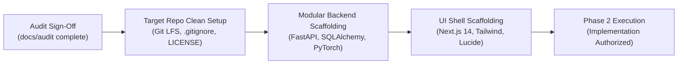

# Phase 1.6 Synthesis & Phase 2 Transition Recommendation

**Project:** AI Textile Waste Management Platform  
**Document ID:** `AUDIT-PHASE-1.6-DELIV-05`  
**Target Repository:** `D:\Textile-Waste-Workspace\AI-Textile-Waste-Management-Platform`  
**Audit Phase:** Phase 1.6 — Integration Readiness and Evidence Verification  
**Status:** COMPLETE / AWAITING USER AUTHORIZATION  

---

## 1. Executive Synthesis

Phase 1.6 concludes the comprehensive technical verification of all AI models, accuracy claims, inference architectures, and intellectual property encumbrances across the reference repositories.

Through bytecode inspection, state-dict verification, notebook execution trace analysis, and licensing investigations, we have separated empirical technical reality from marketing claims and unverified assumptions.

```
                      AUDITED COMPONENT STATUS MATRIX
┌──────────────────────────────────────┬──────────────────────┬────────────────────────┐
│ Component                            │ Technical Role       │ Audit Status           │
├──────────────────────────────────────┼──────────────────────┼────────────────────────┤
│ R9 fabric_model_v2.pth               │ Natural Material AI  │ VERIFIED (92.75% Test) │
│ R4 material_classifier.pt            │ Commercial Waste AI  │ VERIFIED (Weights)     │
│ R4 defect_classifier.pt              │ Defect Classifier    │ VERIFIED (7-Class Tax) │
│ R13 fabric_defect_model.keras        │ Keras Defect AI      │ PARTIALLY VERIFIED     │
│ R14 ml_service.py Hardcoded Conf.   │ OpenCV Defect Gate   │ INVALID / REJECTED     │
│ Reference Datasets (All Repos)       │ Raw Image Files      │ BLOCKED (No License)   │
│ Upstream MIT Code (R9, R13, R1)      │ Backend & Frontend   │ VERIFIED (Attribution) │
│ Upstream No-License Code (R4)        │ ML Engine Logic      │ RESTRICTED (Clean-Room)│
└──────────────────────────────────────┴──────────────────────┴────────────────────────┘
```

---

## 2. Key Technical Determinations

### 2.1 Spatial Defect Detection vs Image-Level Classification
- **Critical Finding:** None of the deep learning models in any of the 16 reference repositories perform object detection (bounding boxes / YOLO) or semantic segmentation (masks / U-Net).
- **Reality:** All candidate neural networks (`defect_classifier.pt`, `fabric_defect_model.keras`) are **image-level classification models**. They answer *"Does this image contain a defect, and if so, what type?"*, but they **cannot** indicate *where* the defect is located on the garment.
- **The OpenCV Fallback Reality:** The only spatial localization attempt in the reference pool was in R14 and R15, which used crude OpenCV contour thresholding (`cv2.threshold` for holes and stains). This heuristic fails on patterned or textured fabrics and produced hardcoded, fake confidence percentages (`92.5%`, `88.4%`).
- **Phase 2 Defect Policy:**
  1. For initial deployment, adopt **R4's 7-class ResNet-18 classifier** (`Stain`, `Hole`, `Broken Stitch`, `Needle Mark`, `Pinched Fabric`, `Weave Defect`, `Defect Free`). It intelligently consolidates `horizontal`, `lines`, and `vertical` weave flaws into a single `Weave Defect` category, resolving the extreme misclassification observed in R13.
  2. Implement an **Uncertainty Guardrail** based on confidence margin ($\Delta P < 0.20$) and normalized entropy ($H > 0.70$) rather than relying on uncalibrated scalar thresholds (such as the unverified 70% threshold).
  3. Formally schedule true spatial object detection (e.g. YOLOv8-OBB) for a future roadmap milestone when a properly annotated bounding-box dataset is assembled.

### 2.2 Material Model Dual-Inference Pipeline
- **Policy:** Execute both R9 (ResNet-18 natural fiber specialist) and R4 (ResNet-18 commercial stream specialist) in parallel on every upload.
- **Arbitration Logic:**
  - If R4 predicts a synthetic fiber or blend (`Polyester`, `Poly-Cotton Blend`, `Nylon`, `Viscose`) with $\Delta P \ge 0.25$, accept R4.
  - If both agree on an overlapping natural class (`Cotton`, `Linen`, `Silk`, `Wool`), output consensus with reinforced confidence.
  - If R4 predicts an ambiguous natural fiber, defer to R9's higher empirical precision (92.75% verified test accuracy).
  - If both models exhibit high uncertainty or severe natural vs synthetic conflict, automatically trigger `REQUIRES_MANUAL_INSPECTION`.

### 2.3 Licensing & IP Governance
- **Raw Datasets:** Must **not** be committed or pushed to our public GitHub repository. All raw dataset folders are marked `BLOCKED`.
- **Model Checkpoints:** Pretrained PyTorch ResNet-18 checkpoints can be distributed as external binary releases or via Git LFS with clear non-commercial research attribution, shielding the primary code repository from binary bloat and licensing contamination.
- **Code Reuse:** Incorporate verified business logic, formulas, and schemas from R9, R13, and R1 under MIT attribution; perform a clean-room reimplementation of R4's multi-task architecture to avoid copyright infringement.

---

## 3. Transition Requirements for Phase 2 Entry Gate

Before authorizing the transition from Phase 1.6 (Audit) to Phase 2 (Implementation), the following entry criteria must be satisfied:



### Sign-Off Checklist:
- [x] All 16 reference repositories cataloged and evaluated.
- [x] Candidate model checkpoints inspected at the tensor, architecture, and parameter levels.
- [x] Empirical evaluation claims audited against actual training scripts and notebooks.
- [x] Dual-model material routing and arbitration protocol fully specified.
- [x] Defect classification reality established (image-level vs spatial).
- [x] IP, dataset provenance, and redistribution rules formally documented.
- [ ] User review and explicit approval of Phase 1.6 findings.

---

## 4. Immediate Next Steps Upon User Authorization

When user authorization is granted to proceed to **Phase 2: Core Platform Implementation**, work will commence according to the following phased milestones:

1. **Milestone 2.1: Target Repository Scaffolding & IP Hygiene**
   - Initialize clean `.gitignore` (excluding `.pth`, `.pt`, `.keras`, raw datasets, node_modules, `__pycache__`).
   - Setup project `LICENSE` (MIT) and `CREDITS.md` with full upstream attributions.
   - Establish clean directory hierarchy: `backend/`, `frontend/`, `docs/`, `scripts/`.
2. **Milestone 2.2: AI Inference Engine & Arbitration Microservice**
   - Implement `backend/app/ai/` PyTorch inference engine with unified preprocessing.
   - Implement the `MaterialArbiter` and `DefectArbiter` classes with entropy and margin calculations.
   - Add unit tests verifying mock inference, error handling, and threshold behaviors.
3. **Milestone 2.3: FastAPI Enterprise Backend & Database**
   - Implement modular FastAPI application with SQLAlchemy ORM and Alembic migrations.
   - Implement JWT authentication, RBAC, inventory management, and batch processing.
   - Integrate verified circularity scoring and environmental sustainability formulas.
4. **Milestone 2.4: Modern Next.js Frontend Dashboard**
   - Build responsive Next.js 14 (App Router) interface with Tailwind CSS.
   - Implement multi-image drag-and-drop scanning interface with dual-model confidence meters.
   - Create interactive sustainability reports and inventory tracking views.
