# Material Classification Model Report — Deep Transfer Learning on Natural Textile Fibers

**Project:** AI Textile Waste Management Platform  
**Model Identifier:** `fabric_model_v2.pth`  
**Architecture:** ResNet-18 Deep Residual Network  
**Evaluation Date:** 2026-11-15  
**Evaluation Set:** 138 unseen test images (Stratified 70/15/15 held-out split)  
**Overall Test Accuracy:** **93.48%**  
**Macro F1-Score:** **0.9332 (93.32%)**  
**Average CPU Latency:** **73.19 ms**  

---

## 1. Model Architecture & Training Methodology

### 1.1 Architecture Specification
The material classification model is built upon a standard ResNet-18 deep convolutional architecture consisting of 4 residual stages with bottleneck skip connections, followed by an adaptive average pooling layer and a dedicated linear classification head:

```mermaid
flowchart LR
    IN["Input Tensor<br/>(3, 224, 224)"] --> CONV["Conv1 (7x7, s=2)<br/>+ BatchNorm + MaxPool"]
    CONV --> L1["Layer 1 (64 channels)<br/>2 BasicBlocks"]
    L1 --> L2["Layer 2 (128 channels)<br/>2 BasicBlocks"]
    L2 --> L3["Layer 3 (256 channels)<br/>2 BasicBlocks"]
    L3 --> L4["Layer 4 (512 channels)<br/>2 BasicBlocks"]
    L4 --> POOL["AdaptiveAvgPool2d<br/>(512-dim vector)"]
    POOL --> FC["Linear Classifier<br/>(512 -> 6 Classes)"]
    FC --> OUT["Softmax Probabilities<br/>[Abaca, Cotton, Hessian, Linen, Silk, Wool]"]
```

- **Backbone Parameters:** 11,176,512 parameters.
- **Classification Head:** `nn.Linear(in_features=512, out_features=6)`.
- **Checkpoint File:** `backend/app/ai/models/fabric_model_v2.pth` (44.8 MB).

### 1.2 Two-Stage Transfer Learning Protocol
Training was executed using a two-stage fine-tuning strategy:
1. **Stage 1 — Classifier Warmup:** The pre-trained ImageNet backbone weights were frozen. Only the final linear classification head was trained for 5 epochs using cross-entropy loss and Adam optimizer with learning rate $\eta = 10^{-3}$.
2. **Stage 2 — Deep Fine-Tuning:** The weights of `layer4` and the classification head were unfrozen and trained jointly with cosine annealing learning rate schedule ($\eta = 10^{-4}$ down to $10^{-6}$) for 10 epochs with early stopping patience of 4 epochs.

### 1.3 Data Augmentation & Invariance
Training images were augmented to prevent memorization and ensure lighting invariance:
- Random resized crop ($224 \times 224$, scale range $0.80$ to $1.00$).
- Random horizontal flip ($p = 0.50$).
- Random rotation ($\pm 10^\circ$).
- Color jitter (brightness $\pm 0.15$, contrast $\pm 0.15$, saturation $\pm 0.10$).

---

## 2. Empirical Test Set Evaluation

Evaluation was conducted strictly on the 138 images in the stratified held-out test split (`material_test.json`, exactly 23 unseen images per class).

### 2.1 Summary Metrics

| Metric | Value | Target | Variance | Status |
|---|---|---|---|---|
| **Overall Accuracy** | **93.48%** | $\ge 85.0\%$ | $+8.48\%$ | **PASSED** |
| **Macro Precision** | **94.37%** | $\ge 85.0\%$ | $+9.37\%$ | **PASSED** |
| **Macro Recall** | **93.48%** | $\ge 85.0\%$ | $+8.48\%$ | **PASSED** |
| **Macro F1-Score** | **93.32%** | $\ge 85.0\%$ | $+8.32\%$ | **PASSED** |
| **Weighted F1-Score** | **93.32%** | $\ge 85.0\%$ | $+8.32\%$ | **PASSED** |
| **Average Latency (CPU)** | **73.19 ms** | $\le 200\text{ ms}$ | $-126.81\text{ ms}$ | **PASSED** |

### 2.2 Per-Class Performance Table

| Class Index | Class Name | Test Samples | Precision | Recall | F1-Score | False Positives | False Negatives |
|---|---|---|---|---|---|---|---|
| 0 | **Abaca** | 23 | **1.0000** | **1.0000** | **1.0000** | 0 | 0 |
| 1 | **Cotton** | 23 | **1.0000** | **0.6957** | **0.8205** | 0 | 7 |
| 2 | **Hessian** | 23 | **1.0000** | **1.0000** | **1.0000** | 0 | 0 |
| 3 | **Linen** | 23 | **0.8846** | **1.0000** | **0.9388** | 3 | 0 |
| 4 | **Silk** | 23 | **0.7778** | **0.9130** | **0.8400** | 6 | 2 |
| 5 | **Wool** | 23 | **1.0000** | **1.0000** | **1.0000** | 0 | 0 |
| **Average** | **Macro** | **138** | **0.9437** | **0.9348** | **0.9332** | — | — |

### 2.3 Confusion Matrix

$$\begin{pmatrix}
\text{True \ Pred} & \text{Abaca} & \text{Cotton} & \text{Hessian} & \text{Linen} & \text{Silk} & \text{Wool} \\
\text{Abaca} & \mathbf{23} & 0 & 0 & 0 & 0 & 0 \\
\text{Cotton} & 0 & \mathbf{16} & 0 & 1 & 6 & 0 \\
\text{Hessian} & 0 & 0 & \mathbf{23} & 0 & 0 & 0 \\
\text{Linen} & 0 & 0 & 0 & \mathbf{23} & 0 & 0 \\
\text{Silk} & 0 & 0 & 0 & 2 & \mathbf{21} & 0 \\
\text{Wool} & 0 & 0 & 0 & 0 & 0 & \mathbf{23}
\end{pmatrix}$$

### 2.4 Error Analysis & Boundary Behaviors
- **Coarse Plant & Animal Fibers (Abaca, Hessian, Wool):** Perfect $100\%$ precision and recall ($23/23$). The distinct coarse structural striations of abaca and hessian and the characteristic crimp pattern of wool are completely unmistakable to the residual feature extractors.
- **Cotton vs Silk/Linen Confusion:** 6 cotton swatches were classified as silk, and 1 as linen. Highly mercerized fine-combed cotton has smooth, lustrous surface reflections that resemble lightweight silk plain weaves.
- **Uncertainty Gating Protection:** In our inference engine, when predictions between Cotton and Silk show low margin ($\Delta p < 0.15$), the system automatically flags `is_uncertain=True` and enforces manual operator verification, protecting downstream recycling sorting from misclassification.
