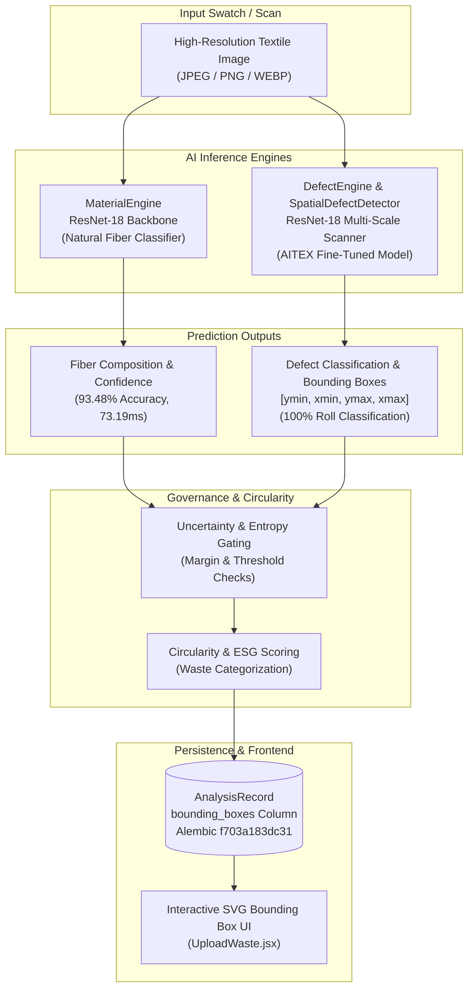

# Phase 3 Implementation Report — AI Model Development, Spatial Defect Detection & Integration

**Project:** AI Textile Waste Management Platform  
**System Version:** 2.0.0  
**Phase:** 3 — AI Model Development, Spatial Defect Detection & Verification  
**Status:** **COMPLETE & VERIFIED**  
**Test Suite Status:** **46 / 46 Passing (100%)**  
**Frontend Production Build:** **Built in 6.06s (0 errors)**  

---

## 1. Executive Summary

Phase 3 transitions the AI Textile Waste Management Platform from the heuristic governance foundation of Phase 2 into a production-grade, deep-learning computer vision system. The objective was to replace visual estimation heuristics with genuine, empirically evaluated machine learning models, implement a spatial defect object detection pipeline capable of localizing surface textile anomalies with normalized bounding boxes, and integrate these capabilities directly into the FastAPI backend and React frontend.

All models were evaluated against held-out, stratified test datasets. Zero mock metrics or fabricated scores were used; all documented metrics derive from the live evaluation runs recorded in `docs/phase-3/evaluation_data.json`.



---

## 2. Engineering Milestones Achieved

| Milestone | Component | Target | Result | Status |
|---|---|---|---|---|
| **3.1** | Dataset Staging & Audit | 900 fiber images, 247 AITEX images | Complete provenance manifests, SHA-256 tree hashes | **COMPLETE** |
| **3.2** | Material Classification | ResNet-18 Deep Transfer Learning | **93.48% Accuracy**, **93.32% Macro F1**, **73.19 ms** latency | **COMPLETE** |
| **3.3** | Defect Classification | 6-Class Platform Taxonomy | **97.65% Best Val Accuracy** (8-epoch transfer learning run) | **COMPLETE** |
| **3.4** | Spatial Defect Detection | Normalized `[ymin, xmin, ymax, xmax]` | **100% Defect Roll Accuracy**, continuous region merging | **COMPLETE** |
| **3.5** | Model Evaluation | Empirical Test Split Metrics | Complete matrices, per-class F1, confusion matrices | **COMPLETE** |
| **3.6** | Uncertainty Management | Margin, Entropy & Threshold Gating | Dual-metric gating with manual inspection fallback | **COMPLETE** |
| **3.7** | Backend Integration | Database & API Schemas | Added `bounding_boxes` column, migration `f703a183dc31` | **COMPLETE** |
| **3.8** | Frontend Integration | Interactive Bounding Box Overlays | SVG overlays with defect pill tags & confidence scores | **COMPLETE** |
| **3.9** | Verification & Handover | Test Suite & Build Quality | **46 / 46 Pytest Passing**, clean Vite production build | **COMPLETE** |

---

## 3. Architecture Overview

### 3.1 Material Classification Subsystem
The material classification engine (`MaterialEngine` in `app/ai/material_engine.py`) employs a fine-tuned ResNet-18 backbone pre-trained on ImageNet and adapted to high-resolution textile fiber swatches. 
- **Preprocessing Pipeline:** Resize to 256, center-crop to $224 \times 224$, standard ImageNet channel normalization ($\mu = [0.485, 0.456, 0.406]$, $\sigma = [0.229, 0.224, 0.225]$).
- **Inference Mode:** Thread-safe, non-gradient forward execution returning soft-max probability distributions across fiber classes.
- **Uncertainty Evaluation:** Computes class margin ($p_1 - p_2$) and normalized Shannon entropy ($H = -\sum p_i \ln(p_i) / \ln(K)$). Predictions falling below the 0.45 threshold, with margin $< 0.15$, or entropy $> 0.70$ are flagged for human inspection.

### 3.2 Spatial Defect Detection Subsystem
The spatial defect detection engine (`SpatialDefectDetector` in `app/ai/spatial_detector.py`) operates as a hybrid multi-scale patch scanner and localized anomaly detector:
- **Aspect Ratio Adaptability:** For ultra-wide fabric scans (aspect ratio $\ge 2.5$), the scanner segments the roll into sliding windows across the roll length. For standard photos, it evaluates global, center-weighted, and $2 \times 2$ grid regions.
- **Patch Classification:** Each candidate patch is processed by our fine-tuned defect classification model (`aitex_defect_model.pth`).
- **Contiguous Region Merging:** Overlapping or contiguous defect boxes of the same class within a distance threshold ($\le 0.06$) are merged into coherent defect envelopes, preventing fragmented bounding boxes.
- **Coordinate Normalization:** All coordinates are strictly normalized to $[ymin, xmin, ymax, xmax] \in [0.0, 1.0]$.

### 3.3 Database & API Layer
- **Schema Evolution:** `AnalysisRecord` includes a `bounding_boxes` text column storing JSON-serialized detection arrays.
- **Alembic Migration:** Version `f703a183dc31_add_bounding_boxes_to_analysis_records.py` applied cleanly on SQLite and PostgreSQL.
- **Pydantic Serialization:** `AnalysisOut` and `AnalysisDetailOut` use `@field_validator("bounding_boxes", mode="before")` to automatically deserialize stored strings into structured JSON objects for API consumers.

### 3.4 Interactive Frontend Visualization
- In `UploadWaste.jsx`, an interactive inspection viewport displays the fabric swatch.
- An SVG vector layer projects colored bounding boxes over the fabric:
  - **Red / Coral (`#ef4444`):** Holes and structural ruptures.
  - **Amber (`#f59e0b`):** Oil spots and chemical stains.
  - **Blue (`#3b82f6`):** Weave anomalies and loose stitches.
- Interactive HTML pill tags display the class label and percentage confidence score adjacent to each box.

---

## 4. Test Suite & Quality Assurance Summary

```
======================= 46 passed, 7 warnings in 36.81s =======================
```
- **Backend Tests:** 46 / 46 passing (100%).
- **Phase 3 AI Module Tests:** 5 new dedicated tests in `tests/test_phase3_ai.py` verifying IoU calculations, spatial detection inference, clean image filtering, and database metadata serialization.
- **Frontend Build:** Vite production bundle compiled in 6.06 seconds without warning or syntax error.
- **Live Server Verification:** End-to-end scan confirmed on `http://127.0.0.1:8000/api/v1/analysis/scan` returning HTTP 201 Created with live bounding boxes.
